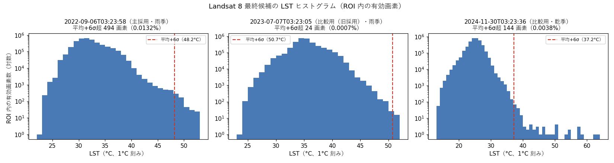
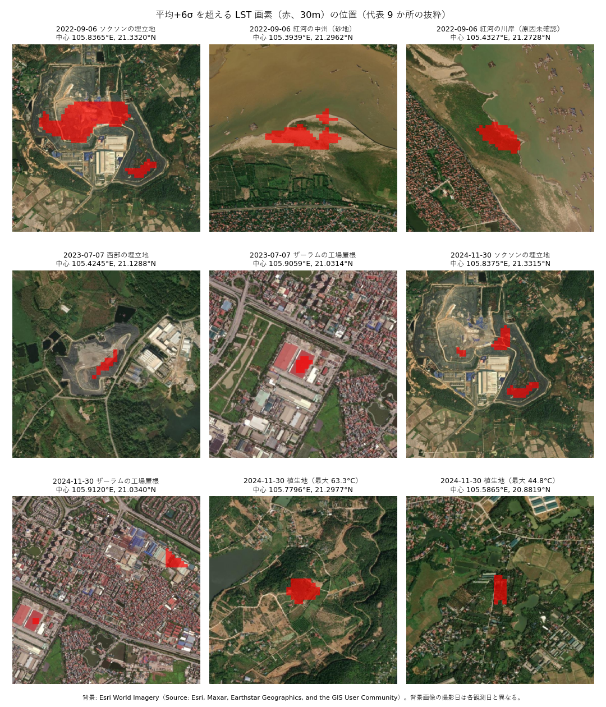

# 観測（シーン）選定基準とROIカバー率

**最終更新**: 2026-10-21
**関連ドキュメント**: [calc_urban_params_guide.md](calc_urban_params_guide.md), [satellite_only_analysis_results.md](../03_results/satellite_only_analysis_results.md), [gee_calc_LST.md](gee_calc_LST.md), [CodingRule.md](CodingRule.md), [gis_data_buildings.md](../01_planning/gis_data/gis_data_buildings.md)
**前提知識**: ROIと有効カバレッジの違い（本ファイル冒頭の[用語]参照）、Landsat 8 / 9シーン探索の基本フロー（[gee_search_satellite_data.py](../../src/gee/gee_search_satellite_data.py)）

---

## 用語

- **実効ROIカバー率**: 本ドキュメントで定義する新指標。シーンのROI被覆率と有効ピクセル率を掛け合わせ、ROI全体に対して実際に分析へ使える面積の割合を表す（定義は2章）
- **有効カバレッジ／有効域**: 実際に信頼して使えるデータ範囲。ROI全体と同一視しない（[CLAUDE.md](../../CLAUDE.md)の用語集と同一）

---

## 1. 背景・課題

観測（シーン）選定の既存指標 `pair_valid_pixel_ratio`（LSTと衛星指標の有効ピクセル率の平均）は、
分母が「シーン∩ROI」であり、**ROI全体に対するカバー率を表していなかった**。

Landsat 8のシーン footprint は東西に隣接する2パス（軌道）で構成され、ROI（ハノイ都市圏）を
単独シーンで完全にカバーできないことが多い。そのため、シーン内の有効ピクセル率だけを見て
選定すると、シーンがROIの一部しか覆っていない観測を「高品質」と誤判定するおそれがある。

本ドキュメントは、この問題を解消する新指標「実効ROIカバー率」の定義と、それに基づく
採用観測の選定根拠を記録する**正本**である。

---

## 2. 指標の定義

```text
effective_roi_coverage = scene_coverage_ratio × valid_pixel_ratio
```

**単位に注意する。** 探索結果CSV（`data/output/gee_search_satellite_data_results.csv`）は
`scene_coverage_ratio` が **0–1**、`lst_valid_pixel_ratio` / `indices_valid_pixel_ratio` が
**0–100（%）** で記録されている。新設列は `*_valid_pixel_ratio` に合わせて **0–100（%）** に統一する。

| 列名 | 定義 |
|---|---|
| `lst_effective_roi_coverage` | `scene_coverage_ratio × lst_valid_pixel_ratio` |
| `indices_effective_roi_coverage` | `scene_coverage_ratio × indices_valid_pixel_ratio` |
| `effective_roi_coverage` | 上記2つの**最小値**。選定キーはこれを使う |

### 最小値を選定キーにする理由

`build_dataset.validate_observation_consistency()` がLSTと衛星指標を同一観測に強制するため、
分析に使えるのは**両方が有効なセル**に限られる。平均を取ると片方の欠測が薄まり、実際に
使えるセル数を過大評価する。したがって最小値（両方が揃って初めて成立する上限）を選定キーとする。

実装は [gee_search_satellite_data.py](../../src/gee/gee_search_satellite_data.py) の
`calculate_effective_roi_coverage()` / `build_effective_roi_coverage_result()` を正本とする。
`process_scene()` の戻り値に含まれ、今後の探索実行でも自動的に記録される。

---

## 3. 再選定結果（GEE再探索なしの再ランキング）

`gee_search_satellite_data.py --rerank-only` は、GEEへ再接続せず既存の探索結果CSVから
実効ROIカバー率3列を算出し、`effective_roi_coverage` 降順のランキングCSV
（`data/output/gee_search_observation_ranking.csv`）を出力する。

2023–2024年の探索結果132件（Landsat 8のみ）を再ランキングした上位5件と、比較対象の当時の採用観測は次の通り。
探索結果はその後、Landsat 9を加えて2022年以降へ拡張した（7章）。本章の順位は拡張前の132件での値である。

| 順位 | 観測日時（UTC） | シーン被覆率 | LST有効率 | 指標有効率 | 実効ROIカバー率 | 雲量(%) |
|---|---|---|---|---|---|---|
| 1 | `2024-11-30T03:23:36` | 0.940 | 99.90% | 99.91% | **93.9%** | 0.02 |
| 2 | `2024-08-10T03:23:00` | 0.931 | 98.59% | 98.16% | 91.4% | 40.14 |
| 3 | `2023-07-07T03:23:05` | 0.935 | 95.57% | 94.90% | **88.7%** | 32.23 |
| 4 | `2023-07-23T03:23:09` | 0.932 | 88.30% | 85.73% | 79.9% | 20.97 |
| 5 | `2024-04-20T03:22:52` | 0.937 | 82.48% | 79.59% | 74.5% | 48.29 |
| 12 | `2023-07-07T03:23:29`（当時の採用観測） | **0.526** | 99.60% | 99.57% | 52.3% | 8.38 |

当時の採用観測 `2023-07-07T03:23:29` は雲量こそ低い（8.38%）ものの、シーン被覆率が0.526と
ROIの約半分しか覆っておらず、実効ROIカバー率は12位（52.3%）にとどまる。
これが今回の見直しの直接の動機である。

---

## 4. 検討した代替案（不採用）

以下は検討した上で不採用とした案である。**一度却下した案を蒸し返さない。**

### 4.1 `032305` + `032329` のモザイク合成

30m正準グリッドの `IN_ANALYSIS_AREA == 1` セルを対象に、LSTと3指標（NDVI/NDBI/NDWI）が
ともに有効なセルの割合を実測したところ、合成（和集合）のROI内有効率は95.2%で最良、
両シーンの重複域における継ぎ目（LST残差）もRMSE 0.032°C（温度差のためケルビンと同値）で
実質なしと確認された。

しかし `gee_calc_LST.py` がシーン単位書き出しでモザイク未実装のため、ラスタ段階の合成処理の
新規実装とテーブル命名規則の決定が必要になる。かつ上乗せ分（+6.5pt）はすべて
**30km以遠の農村周縁**であり、都心（0–5km圏）カバレッジは `032305` 単独（100%）と同一。
工数に見合う分析上の利得がないため不採用とした。

### 4.2 `2024-11-30T03:23:36` 単独

実効ROIカバー率1位（93.9%）・雲量0.02%と数値上は最良だが、**11月＝乾季**で
既存の議論（7月＝雨季）と季節軸が異なる。7月を前提にした既存の分析結果との比較が
成立しなくなるため不採用とした。

> **注記（2026-10-21）**: 8章の再選定で、この観測を**比較用の観測**として用いることにした（主採用ではない）。
> 本章の原則（一度却下した案を蒸し返さない）に対しては、前提が2点変わったことによる。(i) 候補集合が Landsat 9・2022年以降へ
> 広がり（7章）、季節を問わずに比べる方針を決めた（8.1）。(ii) 既存の7月の結果と比べられなくなる問題は、主採用を雨季の観測とし、
> この観測を比較用に限ることで扱う。比較の実行は別タスクとし、比べられる量の限界は 8.5 に記す。主採用を単独で11月の観測とする
> 本節の判断は変えていない。

### 4.3 `pair_valid_pixel_ratio`（LSTと指標の平均）を選定キーにする案

片方の欠測が薄まり、実際に使えるセル数を過大評価するため不採用とした（2章参照）。

---

## 5. 採用観測

**主採用は `2022-09-06T03:23:58`（`20220906_032358`）** とし、`2023-07-07T03:23:05`（旧採用）と
`2024-11-30T03:23:36` を比較用の観測とする。Landsat 9 を加えた2022年以降の候補（7章）から選び直した結果であり、
選定基準・画素単位の確認・判断の根拠は8章を正本とする。

| 項目 | 内容 |
|---|---|
| 観測日時（UTC） | `2022-09-06T03:23:58`（Landsat 8・`LC08_127045_20220906`） |
| 実効ROIカバー率 | 93.5%（2022年以降の386件で4位、Landsat 8 で雨季の最上位） |
| 季節 | 9月（雨季）。既存のSatellite Only / Limitedの分析結果（7月）と季節がそろう |
| 値の妥当性 | 平均 ± 6σ を超える画素は 0.013%（埋立地・中州の砂地・工場の屋根と、原因未確認の川岸1か所）で、合否基準（0.1%以下）に合格（8.4） |
| ラスタ | `data/satellite/lst/2022/LST_Landsat8_20220906_032358Z.tif`, `data/satellite/indices/2022/INDICES_Landsat8_20220906_032358Z.tif` |
| 比較用の観測 | `2023-07-07T03:23:05`（旧採用・雨季）、`2024-11-30T03:23:36`（乾季）。ラスタは `data/satellite/{lst,indices}/2023/` に在庫 |

**旧採用（2026-10-21 まで）**: `2023-07-07T03:23:05` 単独（実効ROIカバー率 88.7%、2023–2024年の132件で3位）。
既存の分析結果はこの観測に基づく。主採用の変更に伴う再実行の要否は9章に記す。

---

## 6. ROIカバー率実測値（30m/90m/300mスケール）

旧採用観測（5章）の `idx_20230707_032305` / `lst_20230707_032305` を `python -m src.analysis.urban_params`
で30m/90m/300mの3スケールにて算出し、`LST_VALID_RATIO`（分析グリッドセルごとのLST有効画素率）
の分布を確認した。

| スケール | 分析対象セル数 | `LST_VALID_RATIO` 平均 |
|---|---:|---:|
| 30m | 3,739,454 | 89.26% |
| 90m | 417,694 | 88.83% |
| 300m | 38,235 | 87.34% |

30m実測値（89.26%）は、2章の実効ROIカバー率（GEEのシーン統計から算出、88.7%）と
概ね整合する（差は0.56ポイント）。差の主因は算出方法の違いである。実効ROIカバー率は
GEE側でシーンfootprintとROIポリゴンの面積比を厳密計算するのに対し、`LST_VALID_RATIO`
実測はローカルの分析グリッド（coarseグリッドのbboxで矩形に拡張される）上でのラスタ集計であり、
ROI境界付近のグリッドセルの扱いに若干の差が生じる。

スケールが粗くなるほど（30m→300m）平均カバー率がわずかに低下する傾向が見られるが、
1ポイント台の差にとどまり、いずれのスケールでも約87〜89%が実際に分析に使える
有効域であることを確認した。

---

## 7. Landsat 9 の追加と2022年以降の再探索

### 7.1 条件

候補集合を広げるため、探索対象に Landsat 9（`LANDSAT/LC09/C02/T1_*`）を加え、期間を
2022年まで遡って再探索した。エクスポートは行わず、候補集合（探索結果CSV・ランキングCSV）の
作成までを範囲とする。採用観測（5章）の再選定は本章の範囲外であり、8章で扱う。

| 項目 | 内容 |
|---|---|
| 期間 | `2022-01-01` 〜 `2024-12-31`（終了日は含まない。GEE の `filterDate` の仕様） |
| センサ | Landsat 8 / Landsat 9（設定CSVの `sensors` 列 `L8;L9`） |
| 設定CSV | `data/input/gee_search_info_2022to2024.csv`（`--config-path` で指定する） |
| センサ別の扱い | センサごとにコレクションを取得し、SMW 係数をセンサ別に切り替える（[gee_calc_LST.md](gee_calc_LST.md) 8.2） |
| 結果CSV | `data/output/gee_search_satellite_data_results.csv`（`satellite` 列 `Landsat8` / `Landsat9` でセンサを区別） |

再探索用の設定は、共有の設定CSV（`data/input/gee_calc_LST_info.csv`）とは別のファイルに置く。
共有の設定CSVは `gee_calc_LST.py`・`gee_calc_satellite_indices.py` も既定で読み、両スクリプトは
有効ピクセル比だけで GeoTIFF をエクスポートするため、期間・センサを広げると大量のエクスポートと
Git 管理下の結果CSVの上書きが起きるからである。

```powershell
python -m src.gee.gee_search_satellite_data --config-path data/input/gee_search_info_2022to2024.csv
```

実行は、センサ×年×四半期の24区間に分割して並列に行い、結果を結合したうえで
`--rerank-only` を通した。区間の和集合は上表の期間と同一であり、結合後は1回実行と同じく
観測日時の昇順に並べている。分割は所要時間（概算で1シーンあたり1.5〜2.5分。実行ログは
リポジトリに保存していない）への対処であり、算出内容は1回実行と変わらない。

現在の結果CSV・ランキングCSVは、LST側の雲マスクを変更（7.5）したあとに同じ手順で再探索した値である
（2026-10-18 実行）。7.2〜7.4 の数値は変更後の値に更新しており、変更前後の差は 7.6 に記す。

### 7.2 件数と欠落

生コレクション386件すべてが結果CSVに記録され、**処理に失敗したシーンは0件**だった。

| 年 | Landsat 8 | Landsat 9 | 計 |
|---|---:|---:|---:|
| 2022 | 62 | 61 | 123 |
| 2023 | 75 | 71 | 146 |
| 2024 | 57 | 60 | 117 |
| **計** | **194** | **192** | **386** |

path/row（`126/045`・`126/046`・`127/045`・`127/046`）ごとの件数は、両センサとも各45〜52件で
偏りはない。拡張前の132件（Landsat 8・2023–2024年）はすべて再探索結果に含まれ、雲マスク変更前の再探索では値も一致した
（数値列の最大絶対差 3.8×10⁻¹⁰。変更後の差は 7.6）。シーンが1件もない月は、Landsat 8 が2024年2月・12月、
Landsat 9 が2022年1月である（いずれも T1 コレクションに該当シーンがない）。

### 7.3 実効ROIカバー率の増分

| 条件 | 拡張前（132件） | 拡張後（386件） | 内訳（L8 / L9） |
|---|---:|---:|---|
| 実効ROIカバー率 80%以上 | 3件 | **11件** | 5 / 6 |
| 実効ROIカバー率 50%以上 | 15件 | **43件** | 20 / 23 |

月単位で見ると、実効ROIカバー率50%以上の観測が1件もない月は、Landsat 8 のみでは36か月中23か月
（2023–2024年の24か月では14か月）、Landsat 9 を加えると17か月（同11か月）に減る。新たに観測が
得られた月は2022年4・8・12月、2023年3・9月、2024年5月の6か月である。残る欠落は1〜3月と
5〜7月に集中する。80%以上の観測がある月は36か月中10か月にとどまる。

ランキング上位10件は次の通り（1位・9位以外の8件が拡張で新たに加わった観測）。

| 順位 | 観測日時（UTC） | センサ | シーン | 実効ROIカバー率 | LST平均（°C） |
|---|---|---|---|---:|---:|
| 1 | `2024-11-30T03:23:36` | L8 | `LC08_127045_20241130` | 93.9% | 25.0 |
| 2 | `2023-12-22T03:23:45` | L9 | `LC09_127045_20231222` | 93.7% | 17.7 |
| 3 | `2022-10-16T03:23:51` | L9 | `LC09_127045_20221016` | 93.5% | 31.6 |
| 4 | `2022-09-06T03:23:58` | L8 | `LC08_127045_20220906` | 93.5% | 32.2 |
| 5 | `2023-11-20T03:23:39` | L9 | `LC09_127045_20231120` | 93.4% | 26.0 |
| 6 | `2022-12-19T03:23:50` | L9 | `LC09_127045_20221219` | 93.3% | 21.0 |
| 7 | `2024-10-05T03:23:21` | L9 | `LC09_127045_20241005` | 93.1% | 32.3 |
| 8 | `2022-10-24T03:24:01` | L8 | `LC08_127045_20221024` | 92.9% | 30.9 |
| 9 | `2024-08-10T03:23:00` | L8 | `LC08_127045_20240810` | 91.4% | 32.4 |
| 10 | `2024-04-28T03:23:02` | L9 | `LC09_127045_20240428` | 90.2% | 35.1 |

上位10件はいずれも path/row `127/045` のシーンであり、うち7件が10〜12月の観測である。

### 7.4 センサ間のLST比較

曇天の影響を避けるため、実効ROIカバー率50%以上の観測に限ってROI平均LST（`lst_mean_temp_c`）を比較した。

| センサ | 件数 | 平均 | 標準偏差 | 最小 | 中央値 | 最大 |
|---|---:|---:|---:|---:|---:|---:|
| Landsat 8 | 20 | 30.0 | 3.5 | 24.6 | 30.6 | 36.0 |
| Landsat 9 | 23 | 27.8 | 6.0 | 14.9 | 28.8 | 35.1 |
| Landsat 9（`2022-09-30T03:23:46` を除く） | 22 | 28.4 | 5.4 | 17.1 | 29.7 | 35.1 |

`2022-09-30T03:23:46` は、雲マスクの変更（7.5）で最小値が -102.2°C から -12.0°C に上がったが、ROI平均LSTは14.9°Cで、
同じ雨季の他の Landsat 9 の観測（最小でも 2024-08-18 の 26.9°C）より明らかに低い。-20°C 以上の雲の取り残しが
なお含まれている可能性がある（未確認）ため、除いた行も併記する。

季節別（乾季11〜4月・雨季5〜10月）の平均は、Landsat 8 が乾季27.1°C（6件）・雨季31.3°C（14件）、
Landsat 9 が乾季25.4°C（11件）・雨季30.0°C（12件）で、Landsat 9 がいずれも1〜2°C低い。
ただし、両センサは同日に同じ地点を観測しておらず（両機は8日ずれの軌道）、観測日の構成が異なる。
同一 path/row で観測日（暦日）の差が8日以内の両センサの組（いずれも実効ROIカバー率50%以上。
1つの観測が複数の組に含まれる場合を含む）は15組あり、差（L9 − L8）は -9.2〜+8.8°C とばらつく
（平均 +0.1°C・中央値 +0.7°C）。組の差には8日間の天候・季節変化が含まれ、組どうしも独立ではない。
**分布の比較にとどまり、センサ間の系統差の有無は判定できない。** 複数センサの観測を同一の分析で併用する場合は、この点を前提に置く。

### 7.5 雲の取り残しによるLST汚染

`2022-09-30T03:23:46`（`LC09_127045_20220930`、実効ROIカバー率57.0%）は、ROI内のLST最小値が
-102.2°C・標準偏差15.3°Cで、雲の取り残しによる汚染と考えられる。雲マスクを変更する前の探索では、LST側の雲マスクは原典
（`cloudmask.js` の `sr`）と同じく `QA_PIXEL` の bit 3・bit 4 のみを用い、Dilated Cloud（bit 1）・
Cirrus（bit 2）・Snow（bit 5）は除外していなかった（衛星指標側は除外する）。このマスク条件は両センサに共通である。
下記の検証の結果、LST側の雲マスクに bit 2・bit 5 を加えた（[gee_calc_LST.md](gee_calc_LST.md) 6章・8.1）。
変更前の探索では、386件中、LST最小値が-20°Cを下回る観測は7件（L8 2件・L9 5件）あり、うち実効ROIカバー率
50%以上は上記の1件であった（変更後は 7.6）。以下の検証の値は、いずれも変更前の探索結果CSVとの比較である。

#### QA ビットの検証

[gee_check_lst_cloud_mask.py](../../src/gee/gee_check_lst_cloud_mask.py) で、LST最小値が-20°C未満の
7件とランキング上位20件（採用観測を含む）の計27件について、異常画素（変更前のマスクを通過し、LST < -20°C の画素）の
QA ビットと、マスク候補ごとの影響を集計した（結果: `data/output/lst_cloud_mask_anomaly_qa_bits.csv`・
`data/output/lst_cloud_mask_variant_comparison.csv`）。LST は QA マスクなしで1回だけ計算し、各候補のマスクを
後からかけている。変更前のマスク（`current`）の有効画素数・最小値・最大値・平均・標準偏差は、27件すべてで
探索結果CSVと一致した。全画素数（有効画素率の分母）は2件（`LC08_127045_20240810`・`LC08_127045_20241130`）で
探索結果CSVより多かった（+14,208・+2,809画素）が、探索スクリプトを再実行した値は検証スクリプトと一致した。
探索結果CSVのこの2行が、検証時点の計算結果と異なっていた（再探索で判明した原因は 7.6）。

対象の27件は、雲マスク変更前の探索結果CSV・ランキングCSVから選んでいる。検証スクリプトの既定の入力は現在の
（変更後の）CSVであり、そのまま再実行すると対象は22件になる。同じ27件で再現するには、変更前の2つのCSVを
取り出して `--results-csv-path`・`--ranking-csv-path` に指定する（例: `git show 7884bb0:data/output/gee_search_satellite_data_results.csv`。
ランキングCSVも同様）。

**異常画素の QA ビット**: 変更前のマスクを通過した画素なので、bit 3（Cloud）・bit 4（Cloud Shadow）は定義上すべて0である。
異常画素が300画素以上の4件（`LC08_127045_20220720` 639,192画素・`LC09_127045_20220930` 161,982画素・
`LC09_126046_20240912` 10,243画素・`LC09_126046_20240523` 376画素）では、
**bit 5（Snow）が約50〜100%、bit 2（Cirrus）が50〜99%** の画素に立っていた。残る3件は異常画素が1〜248画素と少ない。Snow/Ice 信頼度は大半が「高」、
Cloud 信頼度は「低」〜「中」で、「高」は無かった。ハノイで雪は考えにくいため、低温の雲が雪・氷と判定され、
Cloud フラグが立たずに残ったと考えられる（推定）。なお、`compute_emissivity()` は bit 5 の画素の放射率を
0.989（雪の値）に置き換えている。

**マスク候補ごとの影響**:

| 候補 | 除外ビット | 異常7件のうち閾値未満が残る件数 | 上位20件の LST 有効画素率の変化（平均／最大の減少） | 上位20件の選定キーの変化（平均／最大の減少） |
|---|---|---|---|---|
| `current` | 3, 4 | 7 | — | — |
| `plus_dilated` | 1, 3, 4 | 5 | -1.40 ／ -4.34 pt | -0.03 ／ -0.40 pt |
| `plus_cirrus` | 2, 3, 4 | 6 | -0.56 ／ -11.10 pt | -0.00 ／ -0.01 pt |
| `plus_dilated_cirrus` | 1, 2, 3, 4 | 5 | -1.80 ／ -11.72 pt | -0.03 ／ -0.40 pt |
| `plus_snow` | 3, 4, 5 | 3 | -0.00 ／ -0.00 pt | -0.00 ／ -0.00 pt |
| `plus_cirrus_snow` | 2, 3, 4, 5 | 2 | -0.56 ／ -11.10 pt | -0.00 ／ -0.01 pt |
| `indices_equivalent` | 0〜5 ＋ QA_RADSAT | 1 | -1.80 ／ -11.72 pt | -0.03 ／ -0.40 pt |

- `2022-09-30T03:23:46` は、`plus_snow` で閾値未満が0画素になり、最小値は -102.2°C → -12.0°C、
  LST 有効画素率は 86.3% → 62.9% となった。選定キー（実効ROIカバー率）は指標側の 57.0% のまま変わらない
- どの候補でも閾値未満が残るのは `2022-07-20T03:23:42`（`LC08_127045_20220720`、実効ROIカバー率7.5%）で、
  `plus_cirrus_snow` でも3,088画素（最小値 -40.7°C）、`indices_equivalent` でも2,781画素が残る
- 上位20件の選定キーがほとんど変わらないのは、指標側のマスクのほうが厳しく、選定キー（LST と指標の小さいほう）は
  指標側で決まっているためである。`plus_cirrus` 系で LST 有効画素率が 11.1 pt 減るのは `2022-11-01T03:23:50`
  （選定キーは 67.97% のまま）である
- 当時の採用観測 `2023-07-07T03:23:05`（8章の再選定後は比較用）は、`plus_snow`・`plus_cirrus_snow` では値が変わらない。bit 1 を含む候補では
  LST 有効画素率が 95.57% → 94.90% となるが、選定キー（88.72%）はほぼ変わらない

実効ROIカバー率は有効画素の**面積**を表す指標であり、残った画素の**値の妥当性**は保証しない。
採用観測を選ぶ際は、ランキングに加えてLSTの最小値・標準偏差も確認する。

### 7.6 雲マスク変更後の再探索

7.5 で採用した雲マスク（bit 2・3・4・5）で、7.1 と同じ条件・手順で386件を再探索した（失敗0件）。
`--rerank-only` で結果CSV・ランキングCSVを作り直し、変更前の結果CSVと観測ごとに比較した。

| 項目 | Landsat 8（194件） | Landsat 9（192件） |
|---|---:|---:|
| LST有効画素数が減った観測 | 41件 | 48件 |
| LSTの実効ROIカバー率の変化（平均／最大の減少） | -0.34 ／ -40.3 pt | -0.32 ／ -22.1 pt |
| 選定キー（実効ROIカバー率）が変わった観測（下記の被覆率の変化を除く） | 0件 | 3件（最大 -0.02 pt） |

- LST有効画素数が増えた観測は無い。選定キーは指標側で決まっている観測が大半のため、LST側の減少はほとんど反映されない
- ランキングは1〜49位が変更前と同じで、50位・51位が入れ替わった（`2022-11-01T03:24:14` が 43.81% → 43.79%）。
  7.3 の件数・月別の欠落・上位10件の顔ぶれは変わらない
- 当時の採用観測 `2023-07-07T03:23:05` は、有効画素率・実効ROIカバー率・LST統計量のすべてが変更前と一致した
- LST最小値が-20°Cを下回る観測は7件から2件に減り（`2022-07-20T03:23:42` の -40.7°C と `2024-05-23T03:17:04` の
  -26.6°C）、実効ROIカバー率50%以上の観測では0件になった。2件とも実効ROIカバー率は7.5%以下である
- `export_reason` は3件で `lst_valid_ratio_below_threshold` が加わったが、3件とも元から ROI を完全包含しておらず、
  エクスポート対象かどうかは変わらない

**マスクと無関係な変化**: Landsat 8 の2024-06-07〜2024-11-30の36件（全 path/row）で、シーンのROI被覆率
（`scene_coverage_ratio`）が +0.0005〜+0.0054 増え、LSTの全画素数も +1,910〜+20,223画素増えた。被覆率はマスクを
かける前の footprint から求める値であり、指標側の有効画素率も同じ36件のうち25件で変わったが、指標の統計量（NDVI 等）は
変更前と一致し、実効ROIカバー率の変化は最大0.0008 ptにとどまる。GEE 側でこれらのシーンの footprint が
変わったと考えられるが、原因は未確認である。7.5 で全画素数が一致しなかった2件も、この36件に含まれる。
この2件の検証CSV（`lst_cloud_mask_variant_comparison.csv`）の行は、全画素数が検証時点の値、シーンのROI被覆率が
変更前の探索結果CSVの値であり、両者の時点が揃っていない（`lst_effective_roi_coverage` はこの被覆率から求めている）。
候補どうしの比較は同じシーンの中で行うため結論は変わらないと考えられるが、影響の大きさは確かめていない。

---

## 8. 2022年以降の候補からの採用観測の再選定

7章で広げた候補集合（386件。雲マスク変更後の 2026-10-18 の再探索、7.6）から、採用観測（5章）を選び直す。
**採用の最終判断は研究者が行う。** 選定基準・閾値・絞り込み規則・合否基準は、最終候補の画素単位の確認の
結果を見る前に固定した。結果を見てから基準を決めることを避けるためである。

### 8.1 方針

- **季節を制限しない。** 乾季の観測も、主に採用する観測の候補に含める。季節の定義は 7.4 と同じ
  （乾季11〜4月・雨季5〜10月）とし、10月は雨季から乾季への過渡期として注記する
- **センサは Landsat 8 を優先し、Landsat 9 は次点とする。** 既存の分析はすべて Landsat 8 の観測を使っており、
  センサ間の系統差は判定できていない（7.4）。Landsat 9 を採用する場合は、この前提を明記する
- **分析モデルの性能（R²）や、LST と説明変数（`NDBI` 等）の相関は採用基準に使わない。** 説明変数との関係が
  強く出る観測を選ぶと、RQ1 の結果を循環的に有利にするためである

### 8.2 選定基準

| 区分 | 基準 | 根拠 |
|---|---|---|
| 足切り | 実効ROIカバー率 80% 以上 | 旧採用観測（88.7%）に近い水準の有効面積を確保する |
| 足切り | LST 最小値 -20°C 以上 | 雲の取り残しの目安（7.5） |
| 印付け | （平均 − 最小値）÷ 標準偏差、（最大値 − 平均）÷ 標準偏差の**いずれかが 12 以上** | 実効ROIカバー率は面積の指標であり、値の妥当性は保証しない（7.5）。印の付いた観測が最終候補に入った場合は、画素単位の確認で原因を必ず確かめる |
| 優先 | センサ（Landsat 8 → Landsat 9） | 8.1 |
| 参考 | 季節・月 | 制限しない（8.1）。評価表に明示する |
| 参考 | 雲量（シーン全体） | 低いほど雲の取り残しの危険が小さい |
| 参考 | 都心と郊外の LST 差（°C）と、それを LST の標準偏差で割った値 | 最終候補について算出する。季節に左右されにくいヒートアイランド信号の目安として導入した（定義は下記。この想定は 8.4 の結果で成り立たなかった。8.5） |
| 記録 | NDVI 平均・観測年 | 郊外の水田の作付け状況による基準の変化（農事暦との対応は未確認）と、都市構造データ（建物・土地被覆・人口）の時点との整合を示す |

**LST の標準偏差は季節をまたいで比べない。** 8.3 の11件では、乾季が 1.76〜2.41°C（11〜12月に限ると 1.76〜2.04°C）、
雨季が 2.13〜2.81°C と季節で系統的に違い、標準偏差だけをヒートアイランド信号の目安にすると雨季の観測が
有利になる。このため都心と郊外の差を併用する。

**都心と郊外の区分**: 中心点をホアンキエム湖（105.852°E, 21.028°N。
[gis_data_buildings.md](../01_planning/gis_data/gis_data_buildings.md) のテスト領域の中心と同じ点）とし、
**都心は中心から 0〜5km、郊外は 15〜25km の環**とする。距離は投影座標系（UTM 48N、EPSG:32648）で測る。観測ごとの雲の位置の違いを除くため、
**最終候補すべてで有効な画素（ROI 内）に限って**算出する。4.1 の「30km以遠」は、山地を含みうる
（範囲は未確認）ため郊外に使わない。山地の標高による低温が差を大きく見せるおそれがある。

**画素単位の確認の合否基準**: ROI 内の有効画素のうち、-20°C 未満、または平均 ± 6σ を超える画素の割合が
**0.1% 以下**であれば合格とする。超える場合は、その画素が説明できる地物（工場・焼却・裸地など）か雲の取り残しかを
図で判定し、雲の取り残しであれば不合格とする。

### 8.3 一次選抜（探索結果による）

ランキングCSV（`data/output/gee_search_observation_ranking.csv`）で実効ROIカバー率 80% 以上の観測は11件
（Landsat 8 が5件・Landsat 9 が6件）で、LST 最小値はすべて -20°C 以上である。外れ値の指標（σ）は
ランキングCSVの LST 統計量から算出した。在庫は、LST・指標の GeoTIFF がローカルの `data/satellite/` にあるかを表す。

| 順位 | 観測日時（UTC） | センサ | 月（季節） | 実効ROIカバー率 | 雲量(%) | LST 平均／最小／最大／標準偏差（°C） | 低温側σ | 高温側σ | NDVI 平均 | 在庫 |
|---:|---|---|---|---:|---:|---|---:|---:|---:|---|
| 1 | `2024-11-30T03:23:36` | L8 | 11（乾季） | 93.9% | 0.02 | 25.0 ／ 13.5 ／ 63.3 ／ 2.04 | 5.65 | **18.80** | 0.44 | あり |
| 2 | `2023-12-22T03:23:45` | L9 | 12（乾季） | 93.7% | 9.33 | 17.7 ／ 5.1 ／ 34.5 ／ 1.76 | 7.16 | 9.59 | 0.45 | なし |
| 3 | `2022-10-16T03:23:51` | L9 | 10（雨季・過渡期） | 93.5% | 0.11 | 31.6 ／ 20.4 ／ 52.2 ／ 2.57 | 4.38 | 8.05 | 0.46 | なし |
| 4 | `2022-09-06T03:23:58` | L8 | 9（雨季） | 93.5% | 0.21 | 32.2 ／ 23.0 ／ 52.9 ／ 2.66 | 3.46 | 7.75 | 0.55 | なし |
| 5 | `2023-11-20T03:23:39` | L9 | 11（乾季） | 93.4% | 0.01 | 26.0 ／ 15.6 ／ 45.5 ／ 1.88 | 5.54 | 10.41 | 0.48 | なし |
| 6 | `2022-12-19T03:23:50` | L9 | 12（乾季） | 93.3% | 0.01 | 21.0 ／ 8.2 ／ 44.7 ／ 1.92 | 6.73 | **12.35** | 0.40 | なし |
| 7 | `2024-10-05T03:23:21` | L9 | 10（雨季・過渡期） | 93.1% | 0.12 | 32.3 ／ 20.6 ／ 54.0 ／ 2.81 | 4.16 | 7.70 | 0.44 | なし |
| 8 | `2022-10-24T03:24:01` | L8 | 10（雨季・過渡期） | 92.9% | 11.59 | 30.9 ／ 19.4 ／ 48.4 ／ 2.13 | 5.40 | 8.19 | 0.45 | なし |
| 9 | `2024-08-10T03:23:00` | L8 | 8（雨季） | 91.4% | 40.14 | 32.4 ／ 21.1 ／ 49.0 ／ 2.73 | 4.14 | 6.10 | 0.54 | なし |
| 10 | `2024-04-28T03:23:02` | L9 | 4（乾季） | 90.2% | 2.83 | 35.1 ／ 26.6 ／ 57.0 ／ 2.41 | 3.53 | 9.08 | 0.52 | なし |
| 11 | `2023-07-07T03:23:05`（旧採用） | L8 | 7（雨季） | 88.7% | 32.23 | 35.5 ／ 23.7 ／ 51.7 ／ 2.55 | 4.61 | 6.37 | 0.51 | あり |

11件はいずれも path/row `127/045` のシーンで、ROI を完全には覆っていない（`scene_covers_roi` が偽）。
外れ値の印（12σ 以上）は、`2024-11-30T03:23:36`（高温側 18.80σ、最大値 63.3°C）と
`2022-12-19T03:23:50`（高温側 12.35σ）に付く。低温側は最大でも 7.16σ である。

**絞り込み規則**: 足切りを通った Landsat 8 の観測から、**季節（乾季・雨季）ごとに実効ROIカバー率の最上位1件ずつ**と、
旧採用観測を最終候補とする。Landsat 9 は、Landsat 8 に該当がない季節がある場合だけ加える。
この規則による最終候補は次の3件である（両季節とも Landsat 8 に該当があるため、Landsat 9 は加えない）。

| 最終候補 | 季節 | 選ばれた理由 | 外れ値の印 |
|---|---|---|---|
| `2024-11-30T03:23:36` | 乾季 | Landsat 8・乾季の最上位（全体1位） | あり（高温側 18.80σ） |
| `2022-09-06T03:23:58` | 雨季 | Landsat 8・雨季の最上位（全体4位） | なし |
| `2023-07-07T03:23:05` | 雨季 | 旧採用観測 | なし |

印の付いた `2022-12-19T03:23:50` は Landsat 9 で最終候補に入らないため、画素単位の確認は行わない。
最終候補の画素単位の確認の結果は 8.4、採用の判断は 8.5 に記す。

### 8.4 最終候補の画素単位の確認

**GeoTIFF と探索結果の整合**: 3件の GeoTIFF（LST・指標）を ROI で切り出し、探索結果CSV（GEE 側の集計）と突き合わせた。
有効画素の数は、GEE 側（30m の集計）と GeoTIFF（EPSG:4326 の 0.000269° 格子）で画素の大きさが違うため直接は比べず、
ROI に対する有効画素の割合で比べた。

| 観測 | LST 有効率（GeoTIFF ／ 探索結果） | 指標 有効率（GeoTIFF） | LST 統計量 | 配置先 |
|---|---|---:|---|---|
| `2022-09-06T03:23:58` | 93.51% ／ 93.49% | 93.53% | 平均・最小・標準偏差は一致、最大は 52.86 ／ 52.87°C | `data/satellite/{lst,indices}/2022/`（今回エクスポート） |
| `2023-07-07T03:23:05` | 89.37% ／ 89.35% | 88.74% | 一致（小数第3位まで） | `data/satellite/{lst,indices}/2023/`（在庫） |
| `2024-11-30T03:23:36` | 93.97% ／ 93.94% | 93.97% | 一致（小数第3位まで） | `data/satellite/{lst,indices}/2023/`（在庫） |

差はいずれも 0.03 pt 以内で、6章の実績（0.56 pt）を参考に決めた許容差（1 pt）に収まる。`2024-11-30T03:23:36` は
7.6 の footprint の変化の対象だが、在庫の GeoTIFF は現在の探索結果と整合した。在庫の観測日時のフォルダ（`2023/`）と
観測年（2024年）は一致しないが、既存の参照を壊さないため移動していない。

指標の GeoTIFF のバンド構成は、`2022-09-06`（今回エクスポート）と `2023-07-07`（在庫）が4バンド（NDVI・NDBI・NDWI・MNDWI）、
`2024-11-30`（在庫）だけが3バンド（NDVI・NDBI・NDWI）である。`2023-07-07` は MNDWI を加えるために作り直している
（[limited_analysis_results.md](../03_results/limited_analysis_results.md) のデータセットの世代の説明）。都市構造パラメータの
算出と Limited の分析は4つの指標を前提とするため、`2024-11-30` で分析するには指標の再エクスポートが要る（9.1）。

**合否**: GEE 上の集計（[gee_check_lst_cloud_mask.py](../../src/gee/gee_check_lst_cloud_mask.py)、3件を指定）では、
3件とも現在の雲マスクで -20°C 未満の画素は0画素で、統計量は探索結果CSVと一致した。GeoTIFF で平均 ± 6σ を数えた結果は次の通りで、
**3件とも合格**である。外れた画素はすべて高温側（平均 + 6σ 超）で、低温側の外れは無い。

| 観測 | 平均 + 6σ | 外れ画素 | 割合 | 判定 | 外れ画素の内訳（衛星画像との重ね合わせによる） |
|---|---:|---:|---:|---|---|
| `2022-09-06T03:23:58` | 48.2°C | 494 | 0.013% | 合格 | 埋立地2か所 275画素・紅河の中州と川岸 196画素・工場の屋根 23画素 |
| `2023-07-07T03:23:05` | 50.7°C | 24 | 0.0007% | 合格 | 埋立地 13画素・工場の屋根 11画素 |
| `2024-11-30T03:23:36` | 37.2°C | 144 | 0.0038% | 合格 | 埋立地 62画素・工場の屋根 28画素・植生地2か所 54画素 |





- **埋立地**: ソクソン県北部の大規模な埋立地（黒い遮水シートの区画と処理施設。施設名は未確認）が `2022-09-06` と `2024-11-30` に、
  ROI 西部の埋立地が `2022-09-06` と `2023-07-07` に現れる。複数の観測で同じ場所に現れる、説明できる地物である
- **工場の屋根**: ザーラム付近の大型工場の屋根が3件すべてに現れる。恒常的な高温面である
- **紅河の中州と川岸**（`2022-09-06` のみ）: 中州は乾いた砂地で、日中の高温は説明できる。川岸の1か所（77画素）は植生と砂地が混在し、
  高温の原因は未確認である。観測日の河川の水位は確かめていない
- **植生地**（`2024-11-30` のみ）: 最大 63.3°C の丘陵地と、最大 44.8°C の果樹園状の土地の2か所。画像に熱源となる建物は無く、
  NDVI も 0.44・0.57 と植生を示す。撮影時刻の野焼き・火災である可能性が高い（**推定**。火災検知データとの照合は行っていない）

雲の取り残しは低温側の外れとして現れる（7.5）が、3件とも低温側の外れは無い。背景の衛星画像（Esri World Imagery）の撮影日は
各観測日と異なるため、上記は地物の種類の判定にとどまる。拡大図は外れ画素の塊を代表する9か所の抜粋であり、
`2022-09-06` の ROI 西部の埋立地（19画素）とザーラムの工場屋根（23画素）は、別の観測のパネルと同じ場所である。

**都心と郊外の LST 差**（8.2 の定義。3件に共通の有効画素 3,584,922画素、うち都心 93,873画素・郊外 893,073画素）:

| 観測 | 都心（0〜5km） | 郊外（15〜25km） | 差 | 差 ÷ 標準偏差 |
|---|---:|---:|---:|---:|
| `2022-09-06T03:23:58` | 35.3°C | 32.3°C | **+2.94°C** | 1.10 |
| `2023-07-07T03:23:05` | 37.8°C | 35.8°C | +2.02°C | 0.79 |
| `2024-11-30T03:23:36` | 25.8°C | 25.6°C | **+0.28°C** | 0.14 |

標準偏差は共通の有効画素で求めた値である。乾季の `2024-11-30` は、実効ROIカバー率が最良である一方、都心と郊外の差が
ほとんど無い。郊外の水田が収穫後の裸地になって昇温していることが考えられるが、確かめていない（**未確認**）。

**再現のための記録**:

- GEE 上の集計: `python -m src.gee.gee_check_lst_cloud_mask --scene-indices LC08_127045_20241130 LC08_127045_20220906 LC08_127045_20230707 --threshold-c -20 --anomaly-csv-path <一時フォルダ>/... --variant-csv-path <一時フォルダ>/...`
  （追跡下の `lst_cloud_mask_*.csv` を上書きしないよう、出力先を一時フォルダに向けた。現在の雲マスクは出力の `plus_cirrus_snow` 行に当たる）
- エクスポート: `python -m src.gee.gee_search_satellite_data --config-path data/input/gee_search_info_2022to2024.csv --export --target-observation-datetimes 2022-09-06T03:23:58 --output-csv-path <一時フォルダ>/...`
  （観測日時の完全一致による強制エクスポート。同日のもう1シーン `2022-09-06T03:24:22` は対象外。1回の実行で1観測だけを指定する。
  Drive のフォルダは `LST_hanoi_2022to2024`・`INDICES_hanoi_2022to2024`、エクスポート名は `LST_Landsat8_20220906_032358Z`・
  `INDICES_Landsat8_20220906_032358Z`。Drive から手動でダウンロードして配置した）
- GeoTIFF の集計方法: ROI のシェープファイルを GeoTIFF の格子にラスタ化し（画素中心が ROI 内の画素）、有効な（NaN でない）画素で
  平均・標準偏差・外れ画素を求めた。外れ画素は 8 近傍の連結成分にまとめて位置を出した。都心と郊外の距離は画素中心から
  中心点まで EPSG:32648 で測った。集計と作図に使ったスクリプトはリポジトリに保存していない
- 図: ヒストグラムは 1°C 刻み・縦軸は対数。拡大図はヘッドレス PyQGIS で、外れ画素のマスクを Esri World Imagery に重ねて描いた

### 8.5 採用の判断

**採用観測を1つに絞らず、主採用と比較用の観測に分ける**（研究者の判断）。

| 区分 | 観測 | 根拠 |
|---|---|---|
| **主採用** | `2022-09-06T03:23:58`（L8・9月・雨季） | 実効ROIカバー率 93.5%（旧採用より +4.8 pt）、シーン全体の雲量 0.21%、合否基準に合格、都心と郊外の差が3件で最大（+2.94°C）。雨季であり、既存の7月の結果と季節がそろう |
| 比較用 | `2023-07-07T03:23:05`（L8・7月・雨季） | 旧採用観測。既存の分析結果との接続に使う |
| 比較用 | `2024-11-30T03:23:36`（L8・11月・乾季） | 実効ROIカバー率が最良（93.9%）。都心と郊外の差が小さい乾季の観測として、季節による結果の違いを見る |

3件とも Landsat 8 であり、センサ間の系統差（7.4）は比較に入らない。複数の観測での分析の実行は本章の範囲外である（9章）。
観測どうしを比べる際は、次の点を前提に置く。

- LST の絶対値と標準偏差は観測（季節）で系統的に違うため、比べるのは変数の重要度の順位や、LST の標準偏差で割った誤差などの相対的な量とする
  （8.2 で「標準偏差を季節をまたいで比べない」としたのは標準偏差そのものの大小の比較であり、各観測の誤差を自らの標準偏差で正規化することとは別である）
- `2024-11-30` には、野焼き・火災と推定される高温画素（8.4）が含まれる
- 観測年が 2022・2023・2024 年と異なり、都市構造データ（建物・土地被覆・人口）の時点とのずれが観測ごとに違う

**都心と郊外の差を根拠に使うことの限界**: 8.2 ではこの差を「季節に左右されにくい目安」として導入したが、8.4 の結果は雨季 +2.02〜+2.94°C・
乾季 +0.28°C で、季節に強く左右された。この想定は成り立たなかったため、主採用の根拠としては同じ雨季の観測どうし
（`2022-09-06` と `2023-07-07`）の比較にとどまる。また、都心と郊外の差が大きい観測では、LST と建物・不透水面などの説明変数との関係も
強く出やすいと考えられる（**推定**）。この差は LST だけから求めた量で、説明変数を直接は使っていないが、8.1 で避けた循環的な選び方に
間接的に近づく可能性がある。主採用の判断はカバー率・雲量・合否基準・季節を併せて行っており、この差だけに依っていない。

---

## 9. 今後の扱い

- [satellite_only_analysis_results.md](../03_results/satellite_only_analysis_results.md) の
  既存結果（2023-07-07の観測に `032329` を使用）は、本ドキュメントの実効ROIカバー率で見ると
  ROI約半分（52.3%）に基づく結果である旨を当該ドキュメントに注記した。その後、cell_id 結合経路の
  Satellite Only（[satellite_only_analysis_results_cellbased.md](../03_results/satellite_only_analysis_results_cellbased.md)）と
  Limited（[limited_analysis_results.md](../03_results/limited_analysis_results.md)）は `032305` で実行しており、
  `032329` のままなのは旧経路の satellite_only_analysis_results.md である
- 本ドキュメントで確定した採用観測・選定指標は、後続の都市構造パラメータ算出・
  モデル構築タスクの前提として参照すること

### 9.1 主採用の変更（8章）による既存分析への影響

**主採用を `2023-07-07T03:23:05` から `2022-09-06T03:23:58` に変えたため、主結果を得るには再実行が必要である。**
再実行と、比較用の観測（8.5）での分析は、8章の再選定の範囲外とし別タスクで扱う。`032305` で実行済みの既存の分析結果は、
旧採用（比較用の観測の1つ）に基づく結果として有効である。

| 段階 | 再実行の要否 | 対象 |
|---|---|---|
| 都市構造パラメータ | 要 | `python -m src.analysis.urban_params`（ラスタ → PostGIS テーブル。`lst_20220906_032358`・`idx_20220906_032358` を新たに作る） |
| データセット構築 | 要 | Satellite Only・Limited の gpkg（現在は `dataset_*_20230707_032305_hanoi_30m.gpkg`） |
| 分析 | 要 | [analysis_rq3_limited.py](../../src/analysis/analysis_rq3_limited.py)・[analysis_rq3_satellite_only.py](../../src/analysis/analysis_rq3_satellite_only.py)（既定の入力パスと出力先が `20230707_032305` を指す） |
| 比較用の観測 | `2024-11-30` を新たに実行 | `2024-11-30T03:23:36`。在庫の指標 GeoTIFF に MNDWI が無いため、先に指標を再エクスポートする（8.4）。`2023-07-07` は `032305` で実行済みの結果を使える |

主結果を新しい観測に差し替える際に、追従が要る文書は次の通りである（いずれも旧採用の観測を前提に書かれている）。

- [GIS_IDEAS_poster.md](../03_results/GIS_IDEAS_poster.md)（4.2節を引用している）
- [analysis_rq3_satellite_only_guide.md](analysis_rq3_satellite_only_guide.md)、[qgis_operation_guidelines.md](qgis_operation_guidelines.md)
- [limited_analysis_results.md](../03_results/limited_analysis_results.md)、[satellite_only_analysis_results.md](../03_results/satellite_only_analysis_results.md)、
  [satellite_only_analysis_results_cellbased.md](../03_results/satellite_only_analysis_results_cellbased.md)、[survey_area_comparison_results.md](../03_results/survey_area_comparison_results.md)
- [gis_data_buildings.md](../01_planning/gis_data/gis_data_buildings.md)

**比較可能性の限界**: 新しい主結果と既存の結果は観測（日時・LST の分布）が違うため、LST の絶対値や誤差（°C）は直接比べられない。
比べられるのは、変数の重要度の順位や、LST の標準偏差で割った誤差などの相対的な量にとどまる（8.5）。
