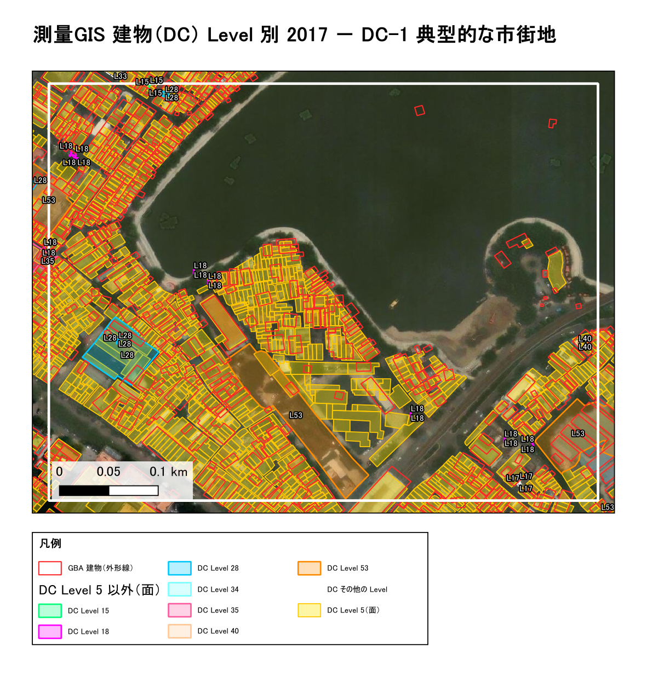
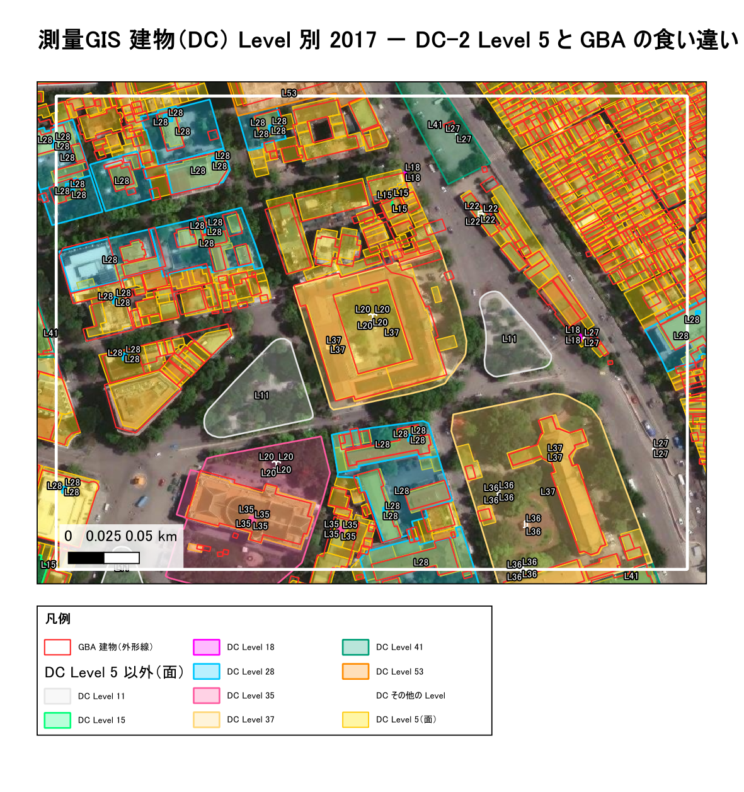
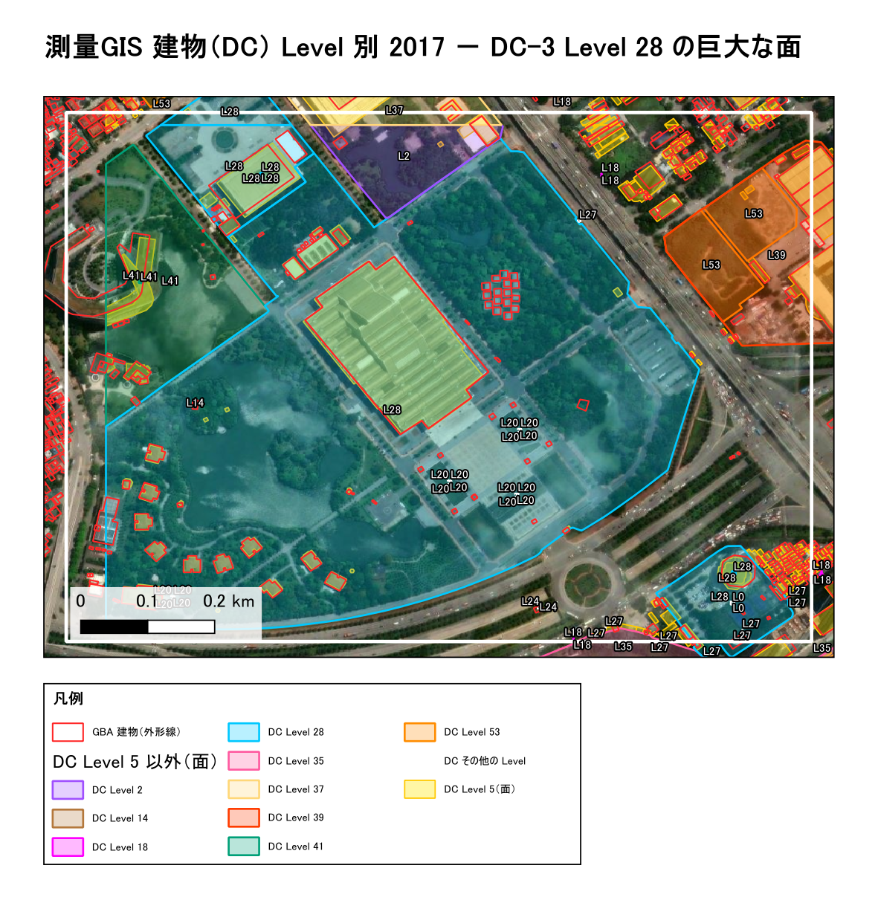
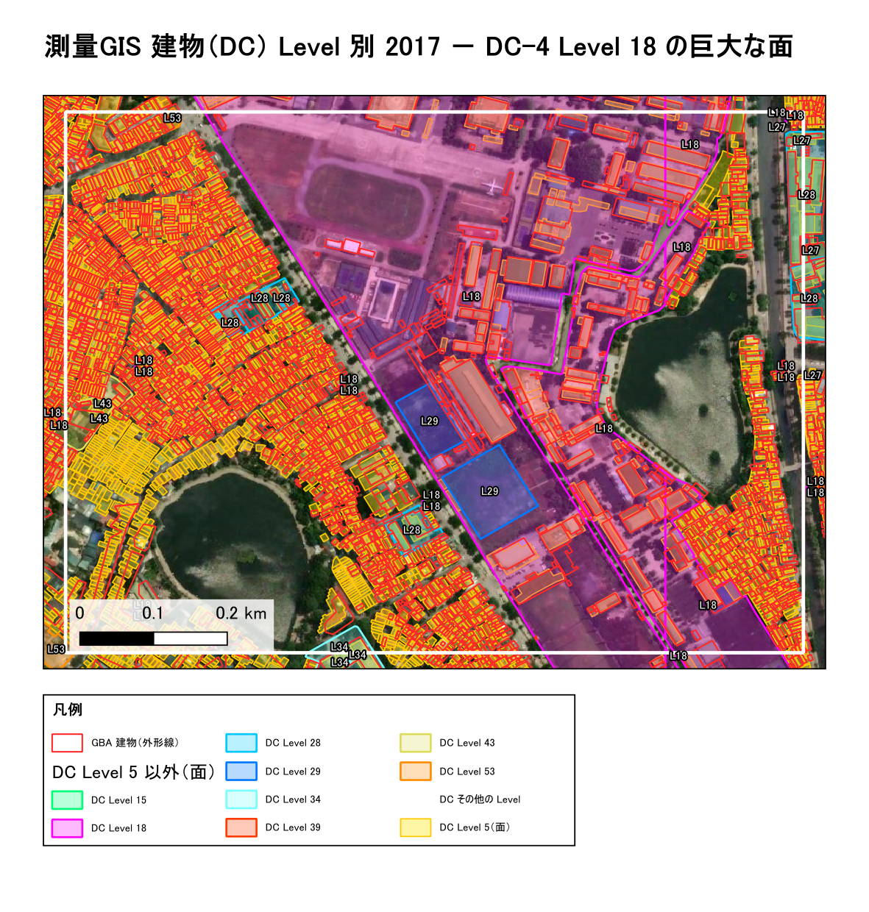
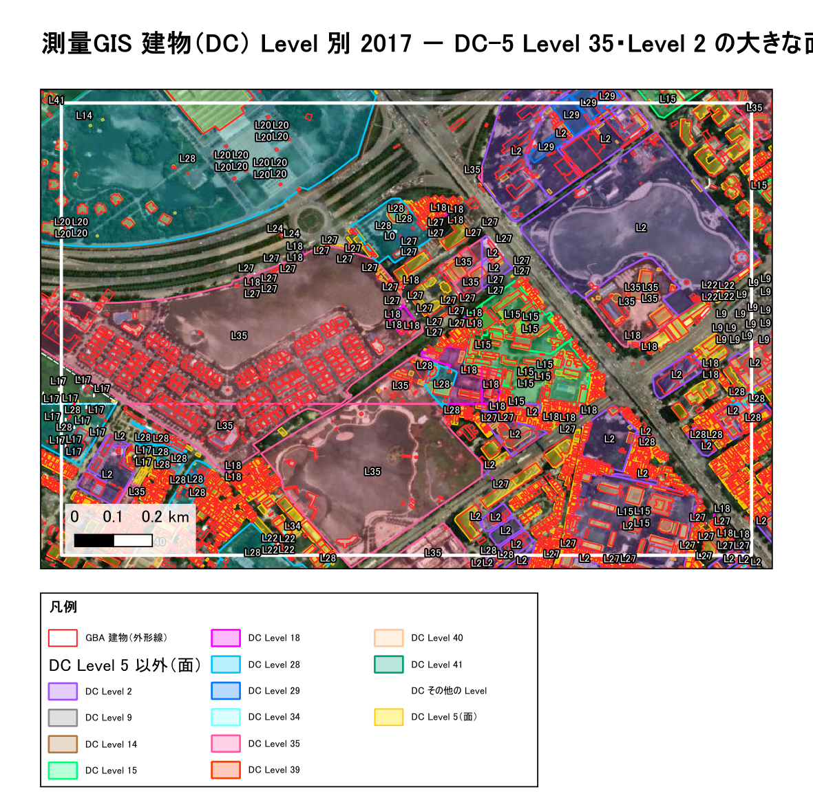
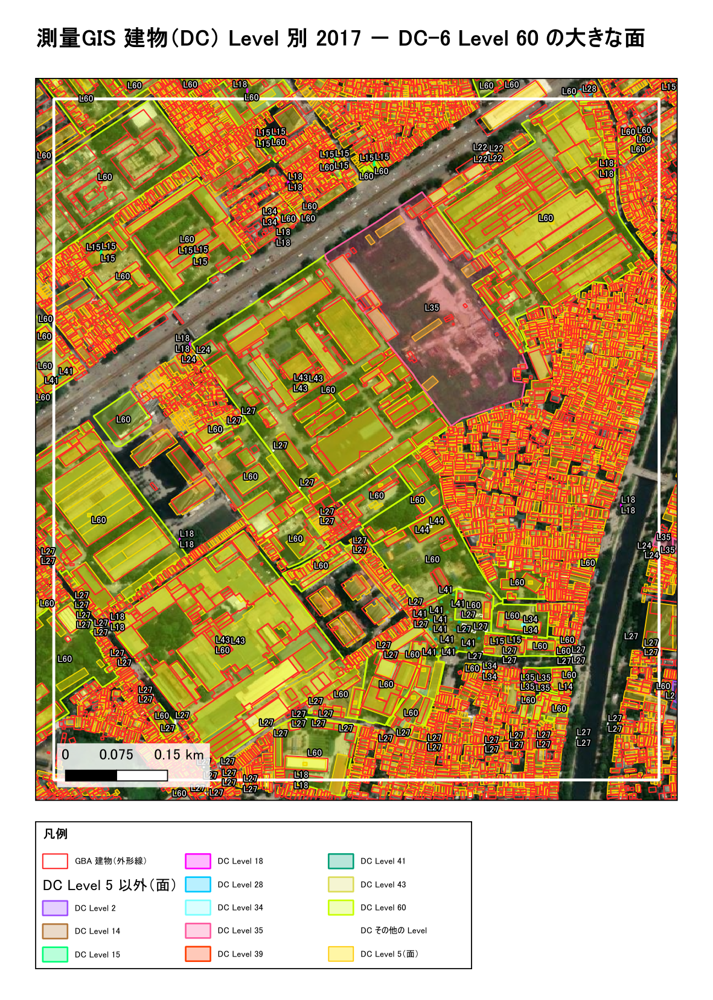
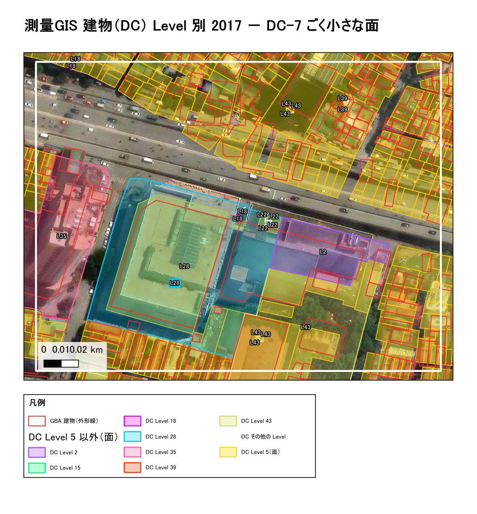
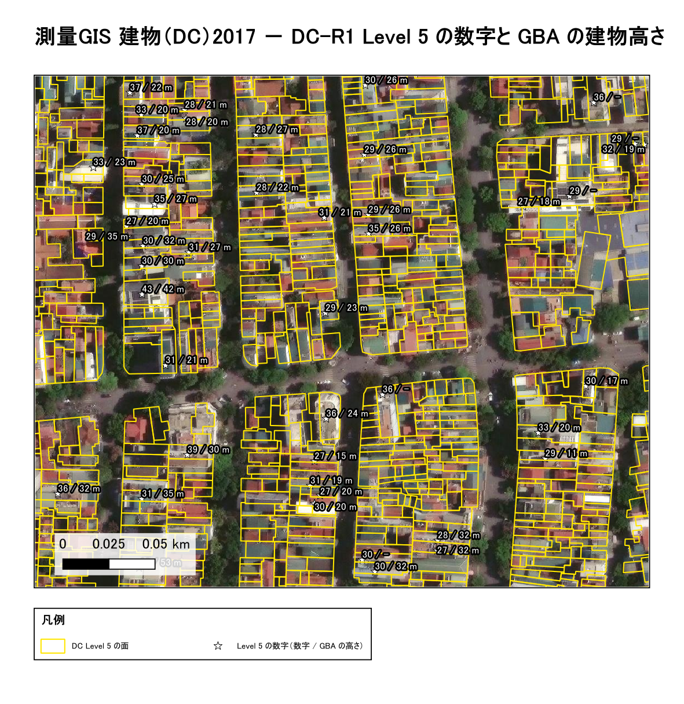
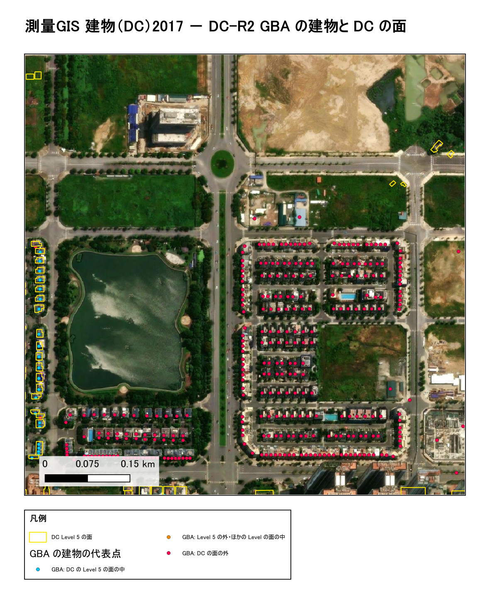

# 測量 GIS DC（建物）の Level 別確認と使える見込み

**最終更新**: 2026-11-19
**作成方法**: Level 別の集計、GBA 建物との重ね合わせ（4 図葉）、代表地点の目視（研究者と Claude、2026-11-11）と、測量範囲全体での公開データとの比較（一時集計、2026-11-18）による。もとは [survey_gis_data_preparation_status.md](survey_gis_data_preparation_status.md) 2.7節にあった内容を移した
**関連ドキュメント**: [survey_gis_attribute_inventory.md](survey_gis_attribute_inventory.md)（共通: 方法・属性列・分かっていないこと・問い合わせ事項）, [survey_gis_gt_inventory.md](survey_gis_gt_inventory.md)（GT の確認）, [survey_gis_data_preparation_status.md](survey_gis_data_preparation_status.md)（整備状況と結論）, [qgis_operation_guidelines.md](../02_methods/qgis_operation_guidelines.md)（図の生成手段）
**前提知識**: 測量 GIS は CAD（DGN）由来で、何の地物かは Level（CAD の描画層の番号）から推測するしかない。Level のコード表と時点は [survey_gis_data_preparation_status.md](survey_gis_data_preparation_status.md) 2.7.1節を参照する

---

## 1. 概要

DC（建物）の Level ごとの中身を確かめ、建物被覆率・棟数密度の算出に使えるかを判断した。**Level 5 の面は建物の外形にほぼ一致し、Level 5 の面に絞れば建物被覆率・棟数密度に条件つきで使える**（研究者判定、2026-11-11。5章）。Level 5 以外の面は施設の敷地と記号である。

2026-11-18 の再調査（4章）で、Level 5 の数字の注記は建物の高さに関係する値とみられること、施設の Level で描かれて Level 5 から漏れる建物は少ないことが分かった。

**確認日**: 2026-11-11  
**目的**: DC（建物）と GT（道路）の属性は CAD 由来の列（`Type`・`Level`・`ColorIndex`・`Weight`・`Style`・`Text` など）しかなく、何が建物・道路かは Level（CAD の描画層の番号）から読み取るしかない。Level ごとの中身を確かめ、建物被覆率・棟数密度・道路密度の算出に使えるかを判断する。  
**方法**: (1) Level 別の件数・形・大きさ・注記（`Text`）の集計、(2) GBA 建物・OSM 道路との重ね合わせの集計（4図葉: 251-b・12-a・219-h・250-g）、(3) QGIS で代表地点（ブックマーク 14 か所）を研究者と Claude がそれぞれ目視。所見は両者を分けて記録する。

---

## 2. Level 別の対応表

Level 5 の面が全体の 95% を占める（面 430,232 件のうち 409,831 件）。Level 5 以外の面は、線の色番号（`ColorIndex`）で大きく 2 種類に分かれる: 色 11 の面は 30 m² を超える大きな面（敷地）、色 10・太さ 0 の面は 30 m² 未満の小さな面（記号とみられる）。Level 5 の面は色 10・太さ 1 である。

| Level | 主な形と件数 | 面の大きさ（中央値） | 同じ Level の注記（解読は未確認） | 目視所見 | 判定 | 建物の算出への採否 |
|---:|---|---:|---|---|---|---|
| 5 | 面 409,831・点 3,709 | 45.7 m² | 数字のみ（27・28・29 など。建物の高さに関係する値とみられる。4.1節） | 建物 1 棟ずつにほぼ一致。複数棟で 1 面のものがある（DC-1・DC-2） | 建物の外形 | **採用** |
| 28 | 面 4,171・点 3,365 | 3.6 m²（最大約 40 万 m²） | 企業・会社（DN、Cty.） | 敷地全体。施設の建物そのものを描く面もある（DC-3） | 企業等の敷地と記号（一部は施設の建物） | 不採用 |
| 18 | 面 5,984・線 2,976 | 0.6 m²（最大約 35 万 m²） | 軍（Q.đội） | 街区・敷地全体を覆う（DC-4） | 軍用地の敷地と記号 | 不採用 |
| 15 | 面 2,181・点 913 | 0.8 m² | 学校（中学・幼稚園・大学） | 目視なし | 学校の敷地と記号（推定） | 不採用 |
| 53 | 面 129・点 1,360 | 3,081 m² | 空き地・建設中・工事 | 建物のない更地に重なる（DC-1） | 空き地・工事中の区画 | 不採用 |
| 35 | 面 507 | 0.5 m²（最大約 25 万 m²） | 文化施設（文化会館など） | 湖・建物・緑地を含む範囲（DC-5） | 文化施設などの敷地（推定） | 不採用 |
| 2 | 面 207 | 2,009 m² | ほぼなし | 湖や複数の街区を囲む（DC-5） | 不明 | 不採用 |
| 60 | 面 108 | 1,170 m² | なし（内側に工場・企業の注記） | 建物が集まった敷地全体（DC-6） | 工場群などの敷地（推定） | 不採用 |
| 27 | 面 1,344・線 628 | 0.4 m² | ほぼなし | 目視なし | 不明（小さな面は記号の疑い） | 不採用 |
| その他の施設 Level（34・14・9・11・41・43・40・37・39 など） | 各数十〜数百 | 1〜20 m² | 病院、寺・亭、墓地、公園、ホテル、工場、銀行、博物館、市場 | 小さな面は建物ではない（DC-7） | 施設種別ごとの敷地と記号（推定） | 不採用 |
| 22・26 | 面 297・266 | 1.4・2.7 m² | なし | 小さな面は建物ではない（DC-7。Level 22） | 記号（推定） | 不採用 |
| 29・45 ほか | 線・点が主 | — | 公安、住民組織名など | — | 注記・線 | 対象外（面がほぼない） |

---

## 3. GBA との重ね合わせ（4図葉）

| 図葉 | GBA の被覆率 | Level 5 の被覆率 | GBA の建物面積のうち Level 5 と重なる割合 | Level 5 の面積のうち GBA と重なる割合 |
|---|---:|---:|---:|---:|
| 251-b（都心） | 41.3% | 58.5% | 82.0% | 57.8% |
| 12-a（南部） | 46.2% | 55.4% | 70.3% | 58.6% |
| 219-h（北部） | 24.1% | 29.2% | 54.8% | 45.2% |
| 250-g（西部） | 13.5% | 9.5% | 58.2% | 82.5% |

計算方法: 図葉の範囲（CS の DGN の範囲から外周 50 m を削ったもの）で、Level 5 の面と GBA の建物をそれぞれ和集合（重なった部分を 1 回だけ数える）にして切り出し、その面積と交差面積から求めた。GBA 側からも Level 5 側からも同じ交差面積を使う。

- 都心・南部では Level 5 が GBA より広く覆う。どちらが実態に近いかは、建物の取りこぼし（両者とも、衛星画像にある建物を欠く場所がある）と、建物でない区画の塗りつぶし（DC-2 の研究者所見）が混在するため決められない
- 250-g では Level 28 の 10 個の面だけで約 45 万 m²（図葉の約 3 分の 1）を占める。Level を区別せずに数えると、この面が建物被覆率に入る
- 1 つの Level 5 の面の中にある GBA の建物の数は、2 棟以上が 3.5〜11.1%、最大 10 棟だった。一方、Level 5 の面の 44〜76% は GBA の建物を 1 つも含まない（Level 5 のほうが細かく分かれる場所が多い）。GBA の分け方も実際の棟とは一致しないため、この数値は目安にとどまる

---

## 4. 再調査（2026-11-18）

**確認日**: 2026-11-18  
**目的**: 5章の判定は、いまある変数（建物被覆率・棟数密度・道路密度）に使えるかという見方で行った。地図の作成者への問い合わせ（[survey_gis_attribute_inventory.md](survey_gis_attribute_inventory.md) 5章）を具体的にするため、DC の注記の数字、施設の Level で描かれた建物、GT の面を、測量範囲の全体で公開データと比べた。  
**方法**: 一時スクリプトによる集計（リポジトリには残していない）と、QGIS での目視（研究者と Claude）。測量範囲は `hanoi_survey_extent.gpkg`（99.9 km²）。GBA の建物・OSM の道路は、主採用の構成で使っている `data/gis/buildings/hanoi_gba_buildings.gpkg`・`data/gis/roads/hanoi_osm_roads.gpkg` を使った。

### 4.1 Level 5 の数字

- Level 5 の点 3,709 件のうち、注記（`Text`）のあるものは 3,708 件、数字として読めるものは 3,401 件である。値は 7〜230 で、中央値 31、四分位は 28〜39。27（495 件）・28（412 件）・29（365 件）が多い。98.5% は Level 5 の面の中にあり、注記のある面の面積の中央値は 147 m²（Level 5 の面全体では 46 m²）
- 注記の位置にある GBA の建物の高さ（2,345 件）との順位相関は 0.71 である
- 数字から地盤の標高（半径 100 m 以内の DH の標高点（Level 8）の中央値。地盤の中央値は 6.5 m）を引くと、5〜95% で 19〜78 m、中央値 24 m になる。この値と GBA の高さとの順位相関は 0.72 である
- 階数とは合わない（数字が 26〜27 の建物の GBA の高さの中央値は 15 m）。最も近い注記との差は 0 が最も多く（758 件）、道沿いの番地の連番とも合わない
- 数字が建物の高さ（m）か屋上の標高（m）かは、地盤の標高の幅が小さい（5〜95% で 5.7〜9.4 m）ため区別できなかった（未確認）。どちらであっても、地盤からおよそ 17 m を超える高い建物にだけ付いているように見える。建物の高さと分かれば、GBA の建物高さ（P4）を確かめる材料になる

### 4.2 施設の Level で描かれた建物

GBA の建物（測量範囲内 269,469 件）の代表点が、DC のどの面の中にあるかを数えた。GBA には同じ形の重複（3,125 件）と、1 万 m² を超える面（31 面・1.40 km²。多くは GBA の `source` が `ours2` の面で、密集した住宅地をまとめて 1 つの面にしている）があるため、これらを除いた 22.75 km² で割合を求めた。

| GBA の建物の位置 | 建物面積の割合 | 高さ 20 m 以上の建物の面積の割合 |
|---|---:|---:|
| DC の Level 5 の面の中 | 78% | 79% |
| Level 5 の外で、ほかの Level の面の中 | 3.7% | 7.6% |
| DC の面の外 | 18% | 13% |

- ほかの Level の面の中にある建物は Level 2・28・53・35・15 の順に多いが、どれも全体の 0.4〜0.5% にとどまる。施設の Level で描かれて Level 5 から漏れる建物は少ない
- DC の面の外にある建物には、DC に面のない住宅地の建物が含まれる（DC-R2）。衛星画像には住宅が写っており、測量より後に建った可能性がある（未確認）

---

## 5. 判定

| 指標 | 判定 | 根拠 | 条件・限界 |
|---|---|---|---|
| 建物被覆率 | **条件つきで使える** | Level 5 の面は建物の外形にほぼ一致する（2章、DC-1・DC-2） | Level 5 の面だけを使う（現行の算出は Level を区別しないため、そのままでは敷地・記号が入る）。複数棟が 1 面になる、測量（2015〜2017年）より後の建物を含まない、一部の施設の建物は施設の Level で描かれ漏れる |
| 棟数密度 | **条件つきで使える** | Level 5 の面の数で数えられる | 上と同じ条件。複数棟が 1 面の場所では少なく、GBA より細かく分かれる場所では多く数える。GBA の棟数とは数え方が違う |

判定は研究者が行った（2026-11-11）。後続として、測量 GIS の建物を Level 5 の面に絞る算出コードの変更を Issue として起票する。問い合わせ事項への反映は [survey_gis_attribute_inventory.md](survey_gis_attribute_inventory.md) 5章（2-3・2-4・3-3・3-6）を参照する。

---

## 6. 目視確認の記録

各図の表示: 黄の塗り = DC Level 5 の面、赤い線 = GBA 建物（DC の図）または OSM 道路（GT の図。実線が車道、点線がその他の道）、色付きの面・線 = それ以外の Level（凡例を参照）、白い枠 = 確認範囲。背景は Esri World Imagery（出典: Esri, Maxar, Earthstar Geographics, and the GIS User Community）で、撮影時期は測量時点（2015〜2017年）より新しい。論文に載せる場合は、Esri の利用条件と出典表記を確かめる（未確認）。

図はヘッドレス PyQGIS で、範囲ごとに切り出して EPSG:4326 に変換したデータから `src/visualization/qgis_figure.py` の `build_gis_figure` で描いた（[qgis_figure_generation.md](../02_methods/qgis_figure_generation.md)「図の生成手段」）。

### DC-1 典型的な市街地

- **研究者**: 黄色はほぼ 1 棟ずつの建物。ただし一部は 2 棟が 1 つの面になっている。GBA は明らかに建物でないものを建物として表示している所があるが、DC にはない。一部の建物は Level 5 で塗られていない
- **Claude**: Level 5 の面は屋根とほぼ一致し、位置のずれは見えない。Level 53 の大きな面は建物のない更地に重なる

### DC-2 Level 5 と GBA の食い違い

- **研究者**: 黄色はあるが赤がないものも、その逆もある。衛星画像では建物があるのに GBA にも DC にもないものもあれば、建物がない区画を塗りつぶしている所もある
- **Claude**: 旧市街側では Level 5 が街区を短冊状に隙間なく埋める。Level 28・41・35・37 などの面は施設の敷地を囲み、その内側の建物は Level 5 で描かれている。Level 11 の面は緑地（公園・花園）に重なる

### DC-3 Level 28 の巨大な面

- **研究者**: 水色の大きな面は明らかに敷地全体
- **Claude**: 公園・広場を含む敷地全体を囲む。中央の大きな建物そのものも Level 28 の面で描かれ、Level 5 ではない

### DC-4 Level 18 の巨大な面

- **研究者**: ピンクは街区全体が覆われているように見える。街区かどうかは分からない
- **Claude**: 運動場・航空機を含む敷地全体を囲む（同じ Level の注記は「軍」が多い）。敷地内の建物は Level 5 で描かれている

### DC-5 Level 35・Level 2 の大きな面

- **研究者**: 湖あるいは池と建物、自然で覆われている。何を意味するのか分からない
- **Claude**: Level 35 は湖とその周りの造成地を含む範囲、Level 2 は湖（内側の注記は調整池公園の事業）や複数の街区を囲む。Level 35 の西側には Level 5 のない密集した建物があり、測量より後に建った可能性がある（未確認）

### DC-6 Level 60 の大きな面

- **研究者**: 建物が集まった敷地全体を覆っている。何を意味するのかは分からない。黄色はないが、衛星画像で明らかに建物があり Level 60 に覆われている面がある
- **Claude**: 工場・企業が集まる敷地群を囲む（内側の注記はタバコ・電球・靴の会社など）。敷地内の建物の多くは Level 5 だが、Level 5 のない建物もある（測量後の新築か描き漏れかは未確認）

### DC-7 ごく小さな面

- **研究者**: 建物ではない。記号かは分からない
- **Claude**: 1 m² 前後の面（Level 18・22・28）は施設の敷地の中に置かれ、記号とみられる。Level 35 の敷地内の高層建物には Level 5 がない

### 再調査の図（2026-11-18）

表示は上と同じく、黄の線 = DC Level 5 の面、白い枠 = 確認範囲、背景は Esri World Imagery（出典: Esri, Maxar, Earthstar Geographics, and the GIS User Community）。図はヘッドレス PyQGIS で `build_gis_figure` により描いた。geopandas で EPSG:5897 として書き出したファイルは、QGIS では EPSG のコードのない座標系として読まれ、測地系の変換が抜けて約 220 m ずれて表示される。このため図では EPSG:5897 を明示して読み込んだ（最初に描いた図はずれていたため描き直した）。

### DC-R1 Level 5 の数字と GBA の建物高さ

- **研究者**: Claude の所見と同じであることを目視で確認した（2026-11-18）
- **Claude**: 白い星が数字の注記で、ラベルは「数字 / 注記の位置の GBA の建物の高さ」。数字は Level 5 の面のうち、周りより大きい建物に付く。数字は GBA の高さに近いか、それより数 m〜十数 m 大きいことが多い（43 と 42 m、33 と 23 m など）

### DC-R2 GBA の建物と DC の面

- **研究者**: Claude の所見と同じであることを目視で確認した（2026-11-18）
- **Claude**: 中央右と下の戸建ての住宅地は、GBA に建物がある（赤）が DC に面がない。左端の Level 5 の面の中の建物（水色）は GBA と合う
