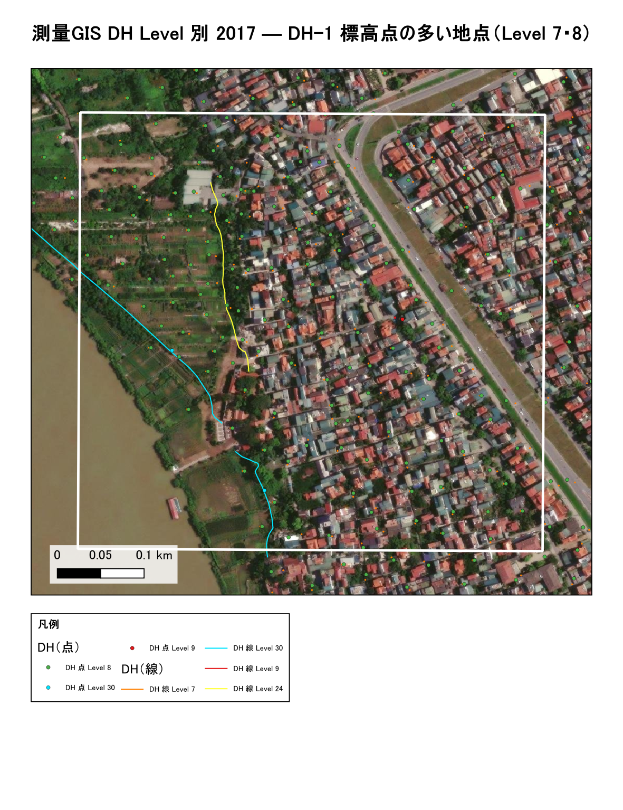
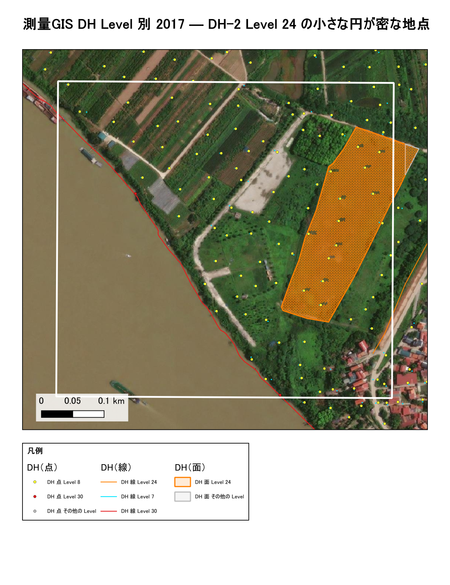
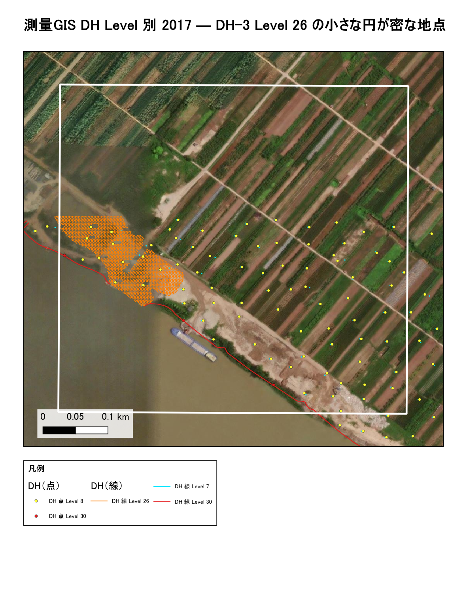

# 測量 GIS DH（地形）の Level 別確認と標高点の詳細

**最終更新**: 2026-11-19  
**作成方法**: `src/analysis/inventory_survey_gis_attributes.py` による属性の集計（`data/output/survey_gis_attribute_inventory/`）と、代表地点の目視（研究者と Claude）による  
**関連ドキュメント**: [survey_gis_attribute_inventory.md](survey_gis_attribute_inventory.md)（共通: 方法・属性列・分かっていないこと・問い合わせ事項）, [survey_gis_data_preparation_status.md](survey_gis_data_preparation_status.md)（整備状況）  
**前提知識**: 測量 GIS は CAD（DGN）由来で、何の地物かは Level（CAD の描画層の番号）から推測するしかない。集計・図の作り方・`Text` の読み方は [survey_gis_attribute_inventory.md](survey_gis_attribute_inventory.md) 1章を参照する

---

## 1. 概要

DH（地形）の主な Level の中身を、集計と代表地点の目視から推定した結果を記録する。あわせて、30 m・90 m・300 m のグリッドの標高として使えるかを検討する材料として、標高点（Level 8 の注記）の値・位置・属性を詳しく調べた結果を記録する（4章）。

- DH に**等高線らしい長い線はない**。線の 99% は周長 0.9〜2.5 m の小さな円である（CS の欄外の注記は「基本の等高線の間隔は 1 m」とする）
- 中身は大きく 2 種類である。**標高点**（Level 7 の円の記号と Level 8 の標高値の注記）と、**区画を小さな円で埋めた模様**（Level 24・26）
- 線・面（模様・川岸の線など）はデータとして使う見込みが薄いため、研究者の目視の対象外とした

---

## 2. 主な Level の推定

主な Level だけを載せる（表に載せた Level でレイヤの地物の 99.5% 以上を占める）。大きさは線の長さ・面の面積の中央値。形の「円」は `Type` 15（楕円）の線である。全 Level の件数は `levels.csv` を参照する。

| Level | 主な形と件数 | 大きさ | 同じ Level の注記（`Text`） | 推定 | 図 |
|---:|---|---:|---|---|---|
| 7 | 線（円）45,510 | 2.5 m | ほぼなし | 標高点の記号 | DH-1 |
| 8 | 点 45,784・線 216 | — | 小数 45,784 件（0.91〜16.85、中央値 6.82。小数点はカンマ。例: 6,46） | 標高点の標高値（m） | DH-1 |
| 9 | 線（円）464・点 351 | 2.5 m | 小数（例: 6,92） | 別の種類の標高点（種類は不明） | — |
| 24 | 線（極小の円）8,447・面 1 | 0.9 m | 小数 17 件（例: 1,5） | 区画を埋める模様（地表の種類は不明） | DH-2 |
| 26 | 線（極小の円）3,312・面 1 | 0.9 m | なし | 川岸の区画を埋める模様（砂地などか。不明） | DH-3 |
| 30 | 線 91・点 91 | 192.6 m | 小数（例: 3,0・4,0） | 川岸に沿う線と数値。崖の高さ（比高）か不明 | DH-1・DH-3 |

L7 の円と L8 の注記は件数がほぼ等しく（45,510 と 45,784）、図でも 1 対 1 に並ぶ。

---

## 3. 目視確認の記録

図の表示（色・白い枠・背景の衛星画像と出典）と地点の選び方は、[survey_gis_attribute_inventory.md](survey_gis_attribute_inventory.md) 1.2節を参照する。

### DH-1 標高点の多い地点

- **研究者**: 標高点（点）について、Claude の所見・4章の調査結果と同じであることを目視で確認した（2026-11-18）。線・面は目視の対象外（データとして使う見込みが薄いため）
- **Claude**: Level 8 の点（標高値）が Level 7 の小さな円の位置に並び、市街地・農地の全体に数十 m 間隔で散らばる。Level 30 の線は紅河の岸に沿う。等高線らしい線はない

### DH-2 Level 24 の小さな円が密な地点

- **研究者**: 目視の対象外（線・面はデータとして使う見込みが薄いため）
- **Claude**: Level 24 の極小の円が、境界線（同じ Level 24 の線と面）で囲まれた細長い区画を埋める。区画は衛星画像では樹木の列に見えるが、模様が何を表すかは分からない

### DH-3 Level 26 の小さな円が密な地点

- **研究者**: 目視の対象外（線・面はデータとして使う見込みが薄いため）
- **Claude**: Level 26 の極小の円が、紅河の岸の水際の区画を埋める。衛星画像（測量より新しい）では水面と砂地にまたがる

---

## 4. 標高点（Level 8 の注記）の詳細

**方法**: 2026-11-18 に一時的な集計で調べた（スクリプトと集計の出力はリポジトリに残していない。このため本章の数値は、出力ファイルと照合できない参考値である）。`merge_DH.gpkg` を 1章の前提（EPSG:5897 を付与、`Text` は latin-1 で読む）で読み、`Text` のカンマを小数点に置き換えて数値にした。測量 GIS 有効域は `data/gis/survey/hanoi_survey_extent.gpkg` を使った。グリッドの数値は、有効域の外接矩形の左下を原点とする EPSG:5897 の正方格子で求めた目安であり、分析で使う正準グリッドとはマスの位置が違う。

### 4.1 点が表すもの

- DH の点 46,254 件は、すべて DGN の文字要素（`Type` 17）である。GDAL は文字要素を、文字を置いた位置（文字列の基準点）の点として読み込む。**点は標高値の注記の位置であり、測った地点そのものではない**
- 測った地点は、Level 7 の円（`Type` 15。45,510 個すべてが半径 0.4 m の同じ大きさの記号）の中心とみられる
- 注記の点から最寄りの円の中心までの距離は、中央値 3.3 m、最も多いのは 2.0 m、95% が 12.2 m 以内である。円の中心は注記の点のおよそ 2 m 西にあり、注記は記号の右側に置かれているとみられる
- 円 1 個に注記 1 個が最寄りとして対応する組が 44,392 組ある（注記 2 個が対応する円は 609 個、注記の付かない円は 452 個）

これらは集計と目視からの推定であり、作成者には確認していない。

### 4.2 Level と属性

| Level | 件数 | 値の例 | 色・太さ・線種・グループ | `ULink` | 推定 |
|---:|---:|---|---|---:|---|
| 8 | 45,784 | 6,82・10,86 | 全件 色 10・太さ 0・線種 0・グループ 0 | 5,500 | 標高値（本体。点の 99%） |
| 9 | 351 | 9,57・12,69 | 同上 | 24 | 標高値。近くの Level 8 より中央値で 0.06 m、上位 10% で 1.4 m 高い。Level 8 との違いは不明 |
| 30 | 91 | 3,0・3,5 | 色 14 | 0 | 小数 1 桁。川岸の線（Level 30）に添える数値で、標高ではないとみられる |
| 24 | 17 | 1,0・2,5 | 色 10 | 0 | 小数 1 桁。模様の区画（Level 24）に添える数値。意味は不明 |
| 7・19・1・5・22 | 4・3・1・1・2 | 5,22・0,5 | — | 3 | 少数。意味は不明 |

- DH の点は、位置と `Text` 以外に属性を持たない（`MSLink`・`EntityNum` は全件が欠損、`GraphicGroup` は全件 0）
- Level 8 の `ULink` は、ODBC のリンク（ID 32047）4,383 件と ID 65 のリンク 1,117 件である。ODBC のリンクの中身は点ごとに違う番号で、外部のデータベースの行番号とみられる。リンク先のデータベースは手元にない

### 4.3 標高値の検査（Level 8）

| 確認したこと | 結果 |
|---|---|
| `Text` が空のもの・数値にできないもの | どちらも 0 件 |
| 埋め草に使われがちな値（0・99.99・99.9・100） | 0 件。9.99（25 件）・9.9（26 件）・10（13 件）は、周りの値の件数と比べて不自然に多くない |
| 値の範囲 | 0.91〜16.85 m、中央値 6.82 m。99% が 4.31〜12.91 m |
| 小数第 2 位の数字の出方 | 0〜9 がほぼ均等（各 4,297〜4,919 件）。丸めた値や作った値ではなく、測った値らしい |
| 書式の揺れ | 45,774 件が小数 2 桁・カンマ。小数点がドットのもの 3 件（7.30・7.90・10.78）、小数 1 桁のもの 7 件（6,2 など。図の南部に集中）。いずれも数値にできる |
| 重複 | 同じ座標（cm 単位）・同じ値の注記が 120 件（60 組）。図葉の重なりによる二重登録とみられる（未確認） |
| ダミー座標 | 0 件 |

高さの基準は、CS の欄外の注記によると国家高さ基準 Hòn Dấu である（[survey_gis_attribute_inventory.md](survey_gis_attribute_inventory.md) 3.2節）。FABDEM などの公開 DEM はジオイド EGM2008 を基準とするため、比べるときは基準の差を考える必要がある。値の絶対的な正しさは確かめていない。

### 4.4 周りの点との比較（外れ値）

各注記の値を、半径 100 m 以内のほかの Level 8 の注記（中央値 22 点）の値の中央値と比べた。

- 差は 98% が ±2.4 m 以内に収まる。3 m を超えるのは 573 件（1.3%）、5 m を超えるのは 152 件
- **周りより 3 m 超高い 263 件の 47.1% は、堤防（TH の Level 44）から 30 m 以内**にある（全体では 1.8%）。堤防の天端の標高とみられる
- **周りより 3 m 超低い 310 件の 23.2% は、水面（TH の Level 4・6・8・40 の面）から 10 m 以内**にある（全体では 4.5%）。池の縁や低い田畑とみられる。残りは説明がつかない
- 最も大きい例は、周りより 9.5 m 低い 3,83 m（X 583,103・Y 2,333,173）と、周りより 8.8 m 高い 15,01 m（X 582,767・Y 2,322,943）である

### 4.5 位置との関係

- **図葉の境目での段差**: 図葉の境目（CS の図郭から求めた近似の 8 列 × 10 行）の両側 30 m の中央値の差は、16 か所のうち 15 か所が 0.3 m 以内で、最大 0.7 m だった。図葉ごとに高さの基準がずれている様子はない
- **測った場所**: 記号の円の中心が建物（DC の Level 5 の面）の中にあるのは 0.3%、道路の路面（GT の Level 17・20 の面）の上にあるのは 32.7% だった。屋根ではなく地面の標高とみられ（未確認）、道路の上で多く測られている
- **`ULink` の偏り**: `ULink` を持つ注記は一部の図葉に集中する（近似の 80 図葉のうち 58 図葉では 0%、10 図葉では 50% 超）。持つ注記の平均標高（6.1〜6.5 m）は持たない注記（7.5 m）より低いが、低い土地の図葉に偏っていることで説明できる

### 4.6 グリッドの充足率

測量 GIS 有効域（99.9 km²）の中の Level 8 の注記は 45,781 件で、1 ha あたり 4.6 点である。

| マスの大きさ | 有効域の中のマスの数 | 点のあるマス | 点のあるマスでの点の数（中央値） |
|---:|---:|---:|---:|
| 30 m | 111,042 | 36.9% | 1 |
| 90 m | 12,363 | 86.5% | 4 |
| 300 m | 1,120 | 93.9% | 44 |

点のないマスはほぼ水面である。90 m の点のないマス 1,675 個の 91.1%、300 m の点のないマス 68 個のすべてが、半分以上を TH の水面の面に覆われている（Level 8 の点のうち TH の水面の面の中にあるのは 45,784 点中 170 点（0.37%）で、川・湖ではほとんど測っていない）。

水面の中の点の数え方（2026-11-19、一時集計。出力は残していない）: `merge_DH.gpkg` の Level 8 の点（45,784 点）と、`merge_TH.gpkg` の Level 4・6・8・40 の面（水面）を、どちらも EPSG:5897 を付与して読んだ。面は `make_valid` で直してから和集合（16.82 km²）にし、点がその中にある（`within`）かを数えた。縁から 10 m 以上内側の点は、和集合を 10 m 内側に縮めた面で同じように数えた。

---

## 5. グリッドの標高として使う場合の論点（後続の候補）

研究者は、DH の標高点を測量 GIS のデータとして 30 m・90 m・300 m のグリッドの標高に使える可能性があると考えている（2026-11-18）。採否と方法の検討は本ドキュメントの範囲外とし、後続のタスクとする。検討の論点は次のとおり。

- **位置**: 標高値は注記（点）から取り、位置は対応する記号の円の中心を使う（注記の位置のままだと 2〜12 m ずれる）。注記と円の対応づけの方法を決める
- **充足率**: 300 m・90 m では大半のマスに点があり、マスの平均として使える見込みがある。30 m では 6 割強のマスに点がなく、補間が要る
- **点の偏り**: 堤防の天端の点はマスの平均を押し上げる。道路の上で多く測られているため、道路が周りより高い場所ではマスの平均が高めに出る可能性がある（未確認）
- **水域の扱い**: 水域にはほとんど点がない（水面の面の中は 0.37%。水面の縁から 10 m 以上内側は 91 点）。考えられる方法は次の 4 つで、どれを選ぶかは研究者が判断する

| 方法 | 内容 | 注意点 |
|---|---|---|
| A | 水域のマスだけ公開 DEM（FABDEM など）の値を使う | 高さの基準が違う（Hòn Dấu と EGM2008）ため、水際に段差が出る。DEM の水面の値も不安定 |
| B | 水域の周りの標高点から内挿する | 推定されるのは岸の高さであり、紅河・西湖のような広い水域では根拠が弱い |
| C | 水域のマスは欠損のままにする | 分析で水域のマスを除外している、または水域率で制御しているなら、水域の標高は不要の可能性がある（分析側の扱いは未確認） |
| D | DH の点で公開 DEM を補正し、補正後の DEM を全域に使う | 面が 1 枚に統一され、水際の継ぎ目ができない。補正の工程が 1 つ増える |

- **高さの基準と精度**: 地図履歴書によると、高さの基準は国家高さ基準 Hòn Dấu、標高点・等高線の高さの誤差は 0.3 m 未満である（[survey_gis_attribute_inventory.md](survey_gis_attribute_inventory.md) 4.1節）。測った地点と注記の関係、Level 9 と Level 8 の違い、LiDAR の DEM の提供は、作成者への問い合わせ事項に含めた（同 5章の 2-5・3-1・3-2）
