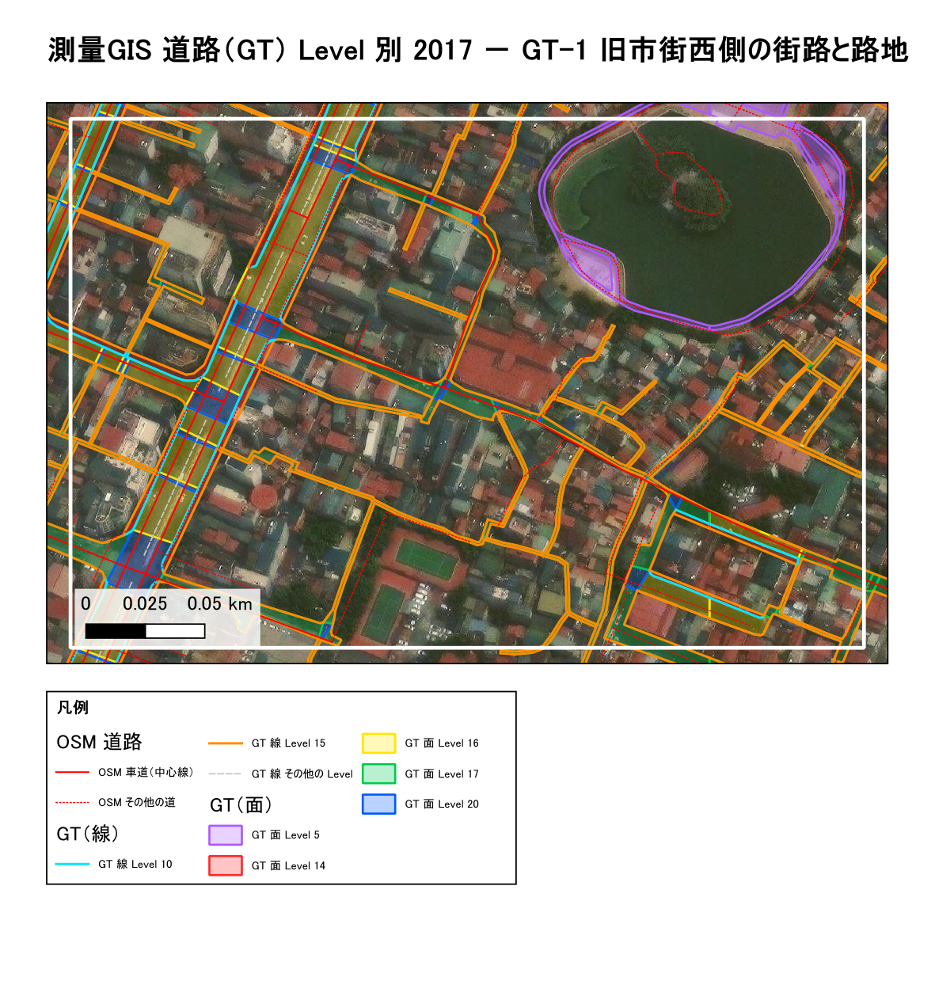
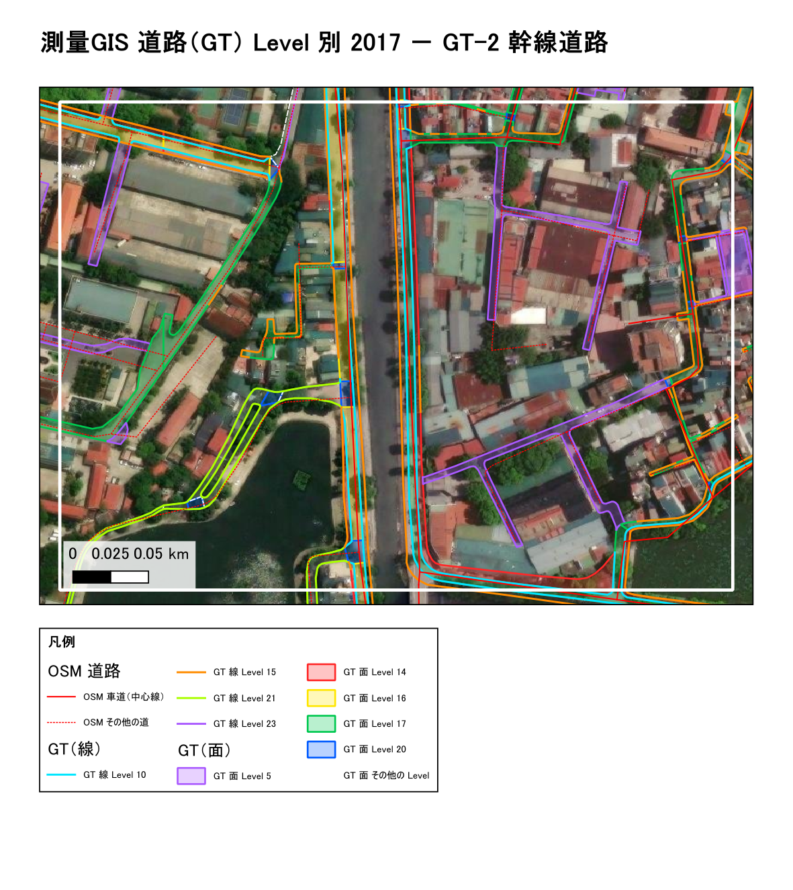
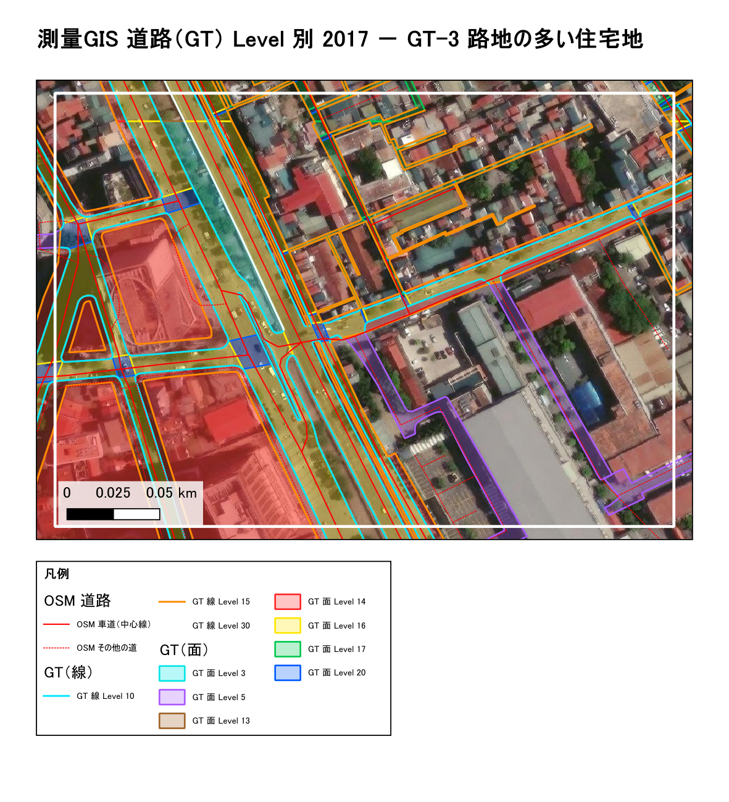
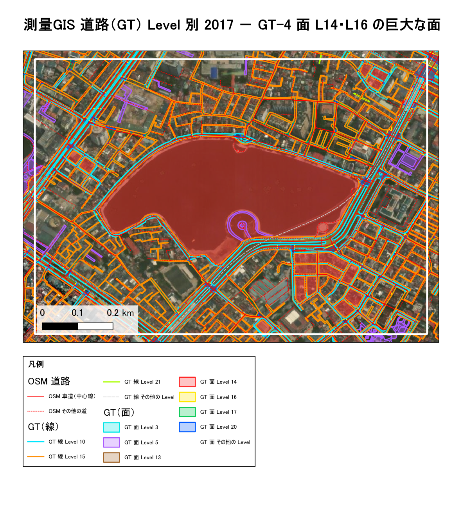
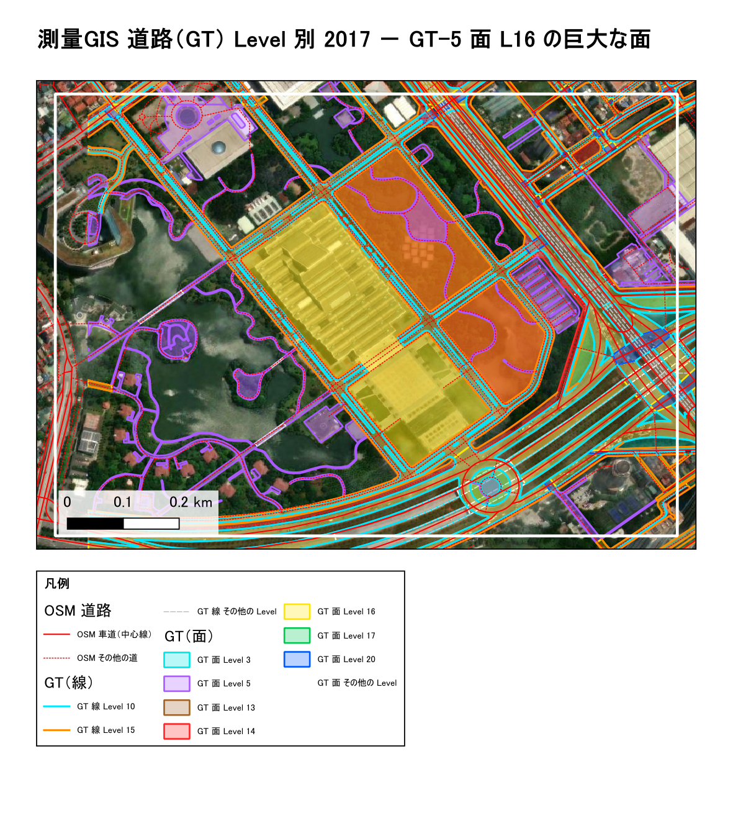
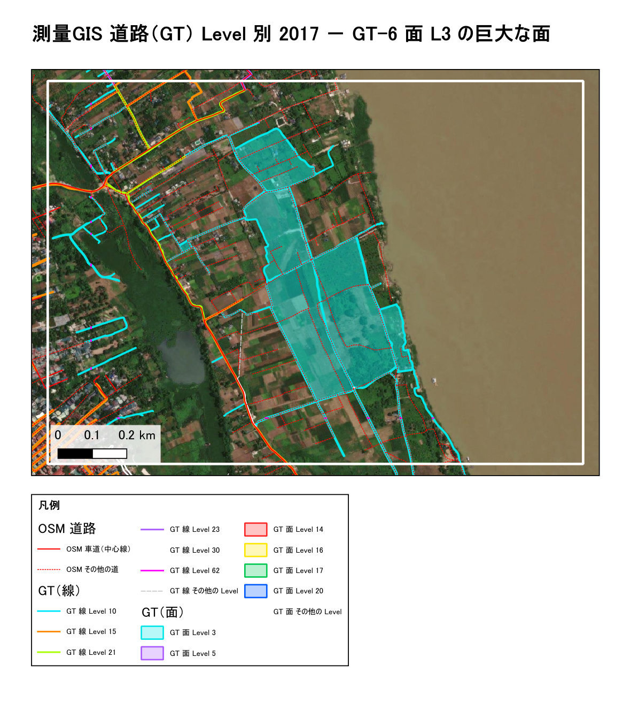
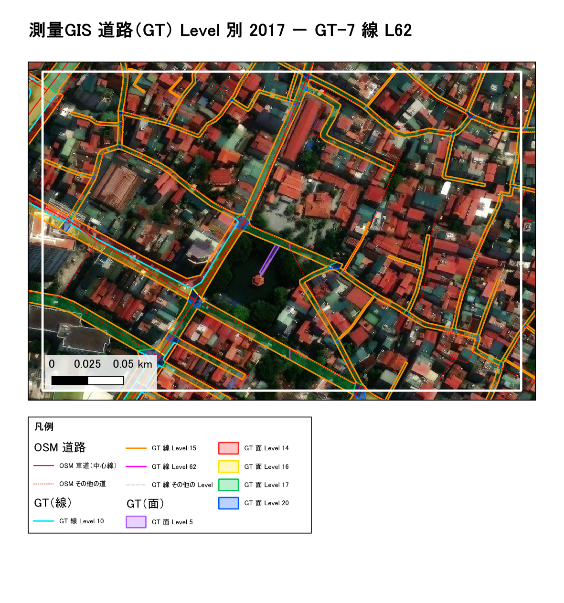
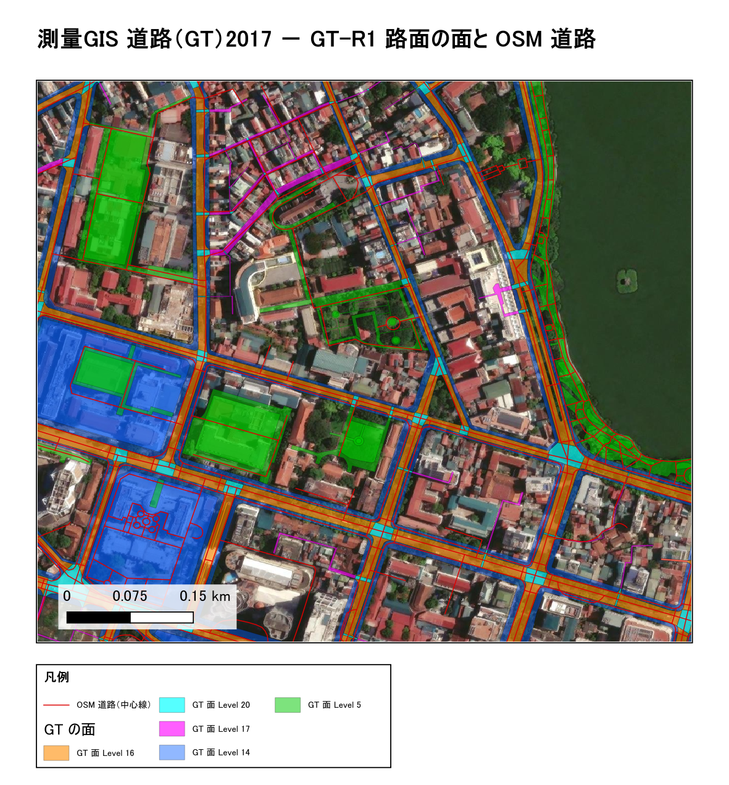

# 測量 GIS GT（道路）の Level 別確認と使える見込み

**最終更新**: 2026-11-19
**作成方法**: Level 別の集計、OSM 道路との重ね合わせ（4 図葉）、代表地点の目視（研究者と Claude、2026-11-11）と、測量範囲全体での面と OSM 道路の比較（一時集計、2026-11-18）による。もとは [survey_gis_data_preparation_status.md](survey_gis_data_preparation_status.md) 2.7節にあった内容を移した
**関連ドキュメント**: [survey_gis_attribute_inventory.md](survey_gis_attribute_inventory.md)（共通: 方法・属性列・分かっていないこと・問い合わせ事項）, [survey_gis_dc_inventory.md](survey_gis_dc_inventory.md)（DC の確認）, [survey_gis_data_preparation_status.md](survey_gis_data_preparation_status.md)（整備状況と結論）, [qgis_operation_guidelines.md](../02_methods/qgis_operation_guidelines.md)（図の生成手段）
**前提知識**: 測量 GIS は CAD（DGN）由来で、何の地物かは Level（CAD の描画層の番号）から推測するしかない。Level のコード表と時点は [survey_gis_data_preparation_status.md](survey_gis_data_preparation_status.md) 2.7.1節を参照する

---

## 1. 概要

GT（道路）の Level ごとの中身を確かめ、道路密度の算出に使えるかを判断した。**線は道路の中心線ではなく両側の縁で、道路密度には使えない**（研究者判定、2026-11-11。4章）。測量建物置き換えでも道路密度は OSM を使う。

2026-11-18 の再調査（3章）で、**面の Level 16・20・17 が道路の路面をほぼ途切れずに描いており、道路面積率の元データとして条件つきで使える見込みがある**と分かった（保留）。

**確認日**: 2026-11-11  
**目的**: DC（建物）と GT（道路）の属性は CAD 由来の列（`Type`・`Level`・`ColorIndex`・`Weight`・`Style`・`Text` など）しかなく、何が建物・道路かは Level（CAD の描画層の番号）から読み取るしかない。Level ごとの中身を確かめ、建物被覆率・棟数密度・道路密度の算出に使えるかを判断する。  
**方法**: (1) Level 別の件数・形・大きさ・注記（`Text`）の集計、(2) GBA 建物・OSM 道路との重ね合わせの集計（4図葉: 251-b・12-a・219-h・250-g）、(3) QGIS で代表地点（ブックマーク 14 か所）を研究者と Claude がそれぞれ目視。所見は両者を分けて記録する。

---

## 2. Level 別の対応表

| Level | 主な形と件数 | 大きさ（中央値） | 目視所見 | 判定 | 道路密度の算出への採否 |
|---:|---|---:|---|---|---|
| 15 | 線 98,297 | 線 17.5 m | 道路の中心線ではなく両側の縁。OSM より線が多い（GT-1〜GT-3） | 道路の縁 | 不採用 |
| 10 | 線 26,478 | 線 21.6 m | 大通りで L15 の内側に平行に走る。L15 との違いは研究者には判別できない（GT-2） | 道路の縁（種類は不明） | 不採用 |
| 62 | 線 1,802 | 線 4.9 m | 縦横の線だけで、縮小すると矩形に並ぶ（GT-7） | 図葉の境目で形を閉じる線（99.4% が図葉の枠線から 1 m 以内） | 不採用 |
| 17 | 面 29,798 | 67.6 m² | 街路の路面を塗る（GT-1 の Claude 所見） | 街路の路面（推定） | 不採用 |
| 20 | 面 18,754 | 11.5 m² | 交差点を塗る（GT-1 の Claude 所見） | 交差点・横断部（推定） | 不採用 |
| 16 | 面 10,985 | 225 m² | 大きな建物と敷地を塗る（GT-5）。幹線道路の車道部も塗る（GT-3 の Claude 所見） | 路面と敷地が混在 | 不採用 |
| 14 | 面 8,973 | 180 m² | 水域と、建物が集まった敷地を塗る（GT-4） | 水域・街区が混在 | 不採用 |
| 5 | 面 2,970・線 979 | 311 m² | 敷地内の通路・公園の園路（GT-2・GT-5 の Claude 所見） | 不明 | 不採用 |
| 3 | 面 449・線 618 | 213 m² | 農地。塗られた農地と塗られていない農地の違いは分からない（GT-6）。中央分離帯の緑地にも重なる（GT-3 の Claude 所見） | 農地・緑地の区画など（推定） | 不採用 |
| 51 | 点 2,913 | — | — | 路地名・道路名の注記 | 対象外 |

- 測量 GIS 有効域（99.9 km²）内の線の総延長は L15 が 3,485 km、L10 が 1,174 km で、OSM の全道路 2,992 km・車道 1,138 km（現行の道路密度で数える道路）を大きく上回る。L15 と L10 の合計は OSM 車道の約 4.1 倍である
- L15・L10 の線から OSM の線までの距離の中央値は 1.7〜4.2 m（4図葉）で、0 m 付近に集中しない。線が中心線ではないことと整合する
- 道路らしいのに GT の線がない場所（GT-2）や、OSM にない路地の線（GT-3）もある。車道と歩道・路地を Level で区別する手がかりは見つからなかった

---

## 3. 再調査: 面と OSM 道路（2026-11-18）

**確認日**: 2026-11-18  
**目的**: 4章の判定は、いまある変数（建物被覆率・棟数密度・道路密度）に使えるかという見方で行った。地図の作成者への問い合わせ（[survey_gis_attribute_inventory.md](survey_gis_attribute_inventory.md) 5章）を具体的にするため、DC の注記の数字、施設の Level で描かれた建物、GT の面を、測量範囲の全体で公開データと比べた。  
**方法**: 一時スクリプトによる集計（リポジトリには残していない）と、QGIS での目視（研究者と Claude）。測量範囲は `hanoi_survey_extent.gpkg`（99.9 km²）。GBA の建物・OSM の道路は、主採用の構成で使っている `data/gis/buildings/hanoi_gba_buildings.gpkg`・`data/gis/roads/hanoi_osm_roads.gpkg` を使った。

| Level | 面の数 | 和集合の面積 | OSM の道路から 5 m 以内にある割合 | DC の Level 5 の面と重なる割合 | 目視 |
|---:|---:|---:|---:|---:|---|
| 16 | 10,985 | 5.87 km² | 86% | 1.5% | 幹線道路の車道の路面（GT-R1）。大きな建物と敷地を塗る所もある（GT-5） |
| 20 | 18,754 | 0.92 km² | 88% | 0.8% | 交差点（GT-R1） |
| 17 | 29,798 | 3.96 km² | 74% | 4.8% | 路地（GT-R1） |
| 14 | 8,973 | 5.56 km² | 48% | 16% | 街区・敷地と水域（GT-R1・GT-4） |
| 5 | 2,970 | 3.34 km² | 42% | 11% | 公園・運動場・緑地（GT-R1） |
| 3 | 449 | 0.60 km² | 30% | 0.4% | 農地など（GT-6） |

- OSM の道路の長さのうち、Level 16・17・20 の面の中にある割合は、secondary 94%・primary 86%・tertiary 84%・residential 66%・service 36%・footway 21% である
- 500 m のセル（測量範囲に 9 割以上入る 388 セル）で数えると、Level 16・17・20 の面積率は中央値 12%（四分位 5〜16%）。OSM の道路密度との順位相関は、全道路で 0.80、車道だけで 0.69 である（Level 17・20 だけでは 0.56・0.46）
- 線は道路の縁で道路密度には使えない（4章）が、面は道路の路面をほぼ途切れずに描いている。**道路面積率（集計単位に占める路面の割合）の元データとして、条件つきで使える見込みがある**。道路面積率は現在の説明変数の候補（[urban_structure_parameters.md](../01_planning/urban_structure_parameters.md)）にないため、加えるかは今後判断する

---

## 4. 判定

| 指標 | 判定 | 根拠 | 条件・限界 |
|---|---|---|---|
| 道路密度 | **使えない** | 線は道路の縁で、延長が OSM 車道の約 4.1 倍。車道と路地を区別できず、面には水域・敷地・農地が含まれる（2章） | 測量建物置き換えでも道路密度は OSM を使う。道路の縁から中心線を作り直す方法は、作業が大きいため今回は採らない |
| 道路面積率（候補） | **保留**（条件つきで使える見込み） | 面の Level 16・20・17 が路面をほぼ途切れずに描き、OSM の幹線道路の 84〜94% がその中に入る（3章） | Level 16 が大きな敷地を塗る所がある（GT-5）。Level の意味は問い合わせ中（survey_gis_attribute_inventory.md の 1・2-1）。説明変数の候補表にないため、加えるかは今後判断する |

判定は研究者が行った（道路密度は 2026-11-11、道路面積率は 2026-11-18）。問い合わせ事項への反映は [survey_gis_attribute_inventory.md](survey_gis_attribute_inventory.md) 5章（1・2-1）を参照する。

---

## 5. 目視確認の記録

各図の表示: 黄の塗り = DC Level 5 の面、赤い線 = GBA 建物（DC の図）または OSM 道路（GT の図。実線が車道、点線がその他の道）、色付きの面・線 = それ以外の Level（凡例を参照）、白い枠 = 確認範囲。背景は Esri World Imagery（出典: Esri, Maxar, Earthstar Geographics, and the GIS User Community）で、撮影時期は測量時点（2015〜2017年）より新しい。論文に載せる場合は、Esri の利用条件と出典表記を確かめる（未確認）。

図はヘッドレス PyQGIS で、範囲ごとに切り出して EPSG:4326 に変換したデータから `src/visualization/qgis_figure.py` の `build_gis_figure` で描いた（[qgis_operation_guidelines.md](../02_methods/qgis_operation_guidelines.md)「図の生成手段」）。

### GT-1 旧市街西側の街路と路地

- **研究者**: 明らかに道路中心線ではなく道路の縁。OSM 道路より明らかに線の量が多い
- **Claude**: Level 15 は街路・路地の両側の縁に沿う 2 本の平行線で、OSM の中心線はその間を通る。大通りでは Level 15 のすぐ内側に Level 10 が平行に走る。Level 17・20 の面は街路の路面と交差点を塗る

### GT-2 幹線道路

- **研究者**: 道路の縁。水色（Level 10）との違いは分からないので推測では答えない。道路らしいのに GT の線がない場所もある。面の道路と線の道路があり、違いも気になる
- **Claude**: 幹線道路でも Level 15・10 は両側の縁。Level 23 の線や Level 5 の細長い面が敷地内の通路を囲む。線がなく面だけが描かれた道路がある

### GT-3 路地の多い住宅地

- **研究者**: OSM より線の数は多い。赤（OSM）がない路地も当然ある
- **Claude**: Level 16 の面は幹線道路の車道部、Level 14 の面は大きな建物を含む街区、Level 3 の細長い面は中央分離帯の緑地に重なる

### GT-4 面 L14・L16 の巨大な面

- **研究者**: 水域が明らかに赤（Level 14）の面で覆われている。建物が集まった敷地も面で塗りつぶされている
- **Claude**: Level 14 の面が湖全体と複数の街区を覆い、道路面ではない

### GT-5 面 L16 の巨大な面

- **研究者**: 大きな建物とその敷地が塗りつぶされている
- **Claude**: Level 16 の面が大きな建物とその敷地を、Level 13 の面が公園・広場を覆う。Level 5 の線・面は公園内の園路

### GT-6 面 L3 の巨大な面

- **研究者**: 農地に見える。塗りつぶされていない農地と塗りつぶされている農地の違いがまったく分からない
- **Claude**: Level 3 の面は紅河沿いの農地の区画を覆う。Level 10 の線は農道・川岸に沿う。OSM の農道の多くに GT の線はない

### GT-7 線 L62

- **研究者**: 分からない。縦の線と横の線しかなく、縮小すると線の集まりが矩形のように見える
- **Claude**: 道路を横切る短い線。集計では 99.4% が図葉の枠線から 1 m 以内にあり、図葉の境目で形を閉じる線とみられる

### 再調査の図（2026-11-18）

表示は上と同じく、黄の線 = DC Level 5 の面、白い枠 = 確認範囲、背景は Esri World Imagery（出典: Esri, Maxar, Earthstar Geographics, and the GIS User Community）。図はヘッドレス PyQGIS で `build_gis_figure` により描いた。geopandas で EPSG:5897 として書き出したファイルは、QGIS では EPSG のコードのない座標系として読まれ、測地系の変換が抜けて約 220 m ずれて表示される。このため図では EPSG:5897 を明示して読み込んだ（最初に描いた図はずれていたため描き直した）。

### GT-R1 路面の面と OSM 道路

- **研究者**: Claude の所見と同じであることを目視で確認した（2026-11-18）
- **Claude**: Level 16 が幹線道路の車道、Level 20 が交差点、Level 17 が路地を塗り、OSM の道路の中心線はその中を通る。Level 14 は官公庁などの街区、Level 5 は公園・運動場・湖岸の緑地を塗る
