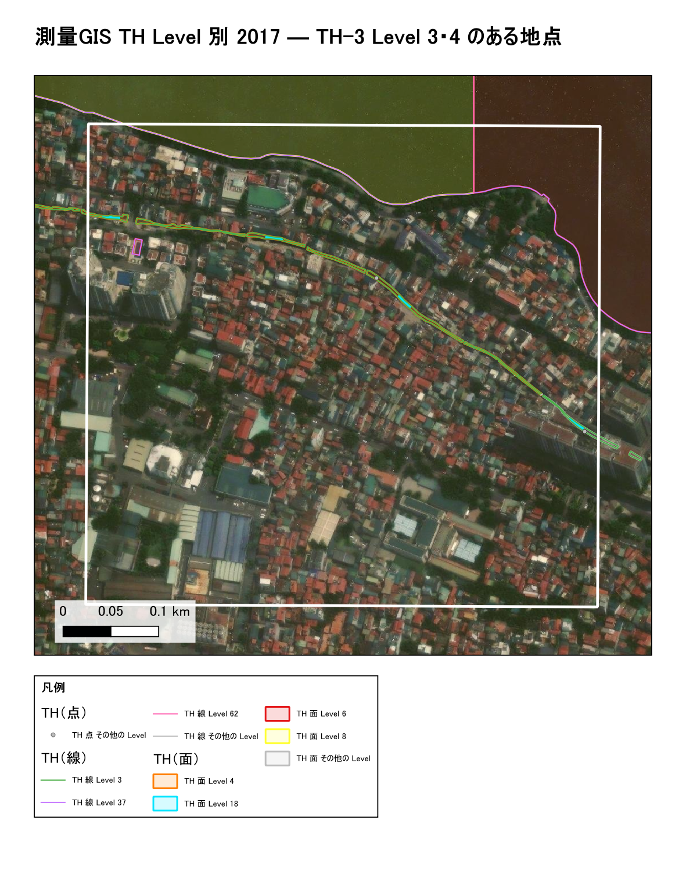

# 測量 GIS TH（水系）の Level 別確認

**最終更新**: 2026-11-18  
**作成方法**: `src/analysis/inventory_survey_gis_attributes.py` による属性の集計（`data/output/survey_gis_attribute_inventory/`）と、代表地点の目視（研究者と Claude）による  
**関連ドキュメント**: [survey_gis_attribute_inventory.md](survey_gis_attribute_inventory.md)（共通: 方法・属性列・分かっていないこと・問い合わせ事項）, [survey_gis_data_preparation_status.md](survey_gis_data_preparation_status.md)（整備状況）  
**前提知識**: 測量 GIS は CAD（DGN）由来で、何の地物かは Level（CAD の描画層の番号）から推測するしかない。集計・図の作り方・`Text` の読み方は [survey_gis_attribute_inventory.md](survey_gis_attribute_inventory.md) 1章を参照する

---

## 1. 概要

TH（水系）の主な Level の中身を、集計と代表地点の目視から推定した結果を記録する。線の 93% は Level 24 の極小の円である。

---

## 2. 主な Level の推定

主な Level だけを載せる（表に載せた Level でレイヤの地物の 99.5% 以上を占める）。大きさは線の長さ・面の面積の中央値。形の「円」は `Type` 15（楕円）の線である。全 Level の件数は `levels.csv` を参照する。

| Level | 主な形と件数 | 大きさ | 同じ Level の注記（解読は未確認） | 推定 | 図 |
|---:|---|---:|---|---|---|
| 24 | 線（極小の円）49,727 | 0.9 m | なし | 川の中の砂州などを埋める模様（`GraphicGroup` 2 が 36,129 件） | TH-2 |
| 4 | 面 79 | 11,803 m²（最大 103 万 m²） | なし | 河川・水路の水面 | TH-1・TH-2・TH-3 |
| 6 | 面 903 | 456 m²（最大 94 万 m²） | 「Hồ Tây」1 件 | 池・湖の水面 | TH-1・TH-3 |
| 8 | 面 27 | 20,280 m²（最大 88 万 m²） | なし | 湖の水面。西湖の一部 | TH-3 |
| 40 | 面 248 | 584 m² | なし | 細い水路・溝の水面（推定） | TH-1 |
| 2 | 線 921・面 12 | 70.6 m | なし | 水域の縁（推定） | TH-1 |
| 37 | 線 892・面 37 | 67.4 m | なし | 水域の縁（推定） | TH-1 |
| 39 | 線 620 | 114.8 m | なし | 不明 | — |
| 3 | 線 209 | 87.8 m | なし | 水路の縁（推定） | TH-2・TH-3 |
| 11 | 線 208 | 186.5 m | なし | 川岸（推定） | TH-2 |
| 44 | 点 194・線 261・面 46 | 90.3 m | 数値（2,0 など）、「điếm canh đê」（堤防の見張り小屋） | 堤防とその付属施設 | TH-1・TH-2 |
| 62 | 線 328 | 10.5 m | なし | 図葉の境目で形を閉じる線（GT の Level 62 と同じとみられる） | TH-1・TH-3 |
| 48・47・45 | 点 125・27・26 | — | 川・湖の名前（sông Tô Lịch、Sông Hồng、Hồ Tây など） | 水域名の注記 | — |
| 52 | 点 27 | — | 「đê Hữu Hồng」（紅河右岸堤）など | 堤防名の注記 | — |
| 38 | 点 30・面 11 | — | 「trạm bơm」（ポンプ場） | ポンプ場 | — |
| 21 | 面 17・点 4 | 20.6 m² | 「giếng」（井戸） | 井戸 | — |

TH-3 では、**同じ湖（西湖）の水面が、図葉の境目（Level 62 の直線）を境に Level 8 の面と Level 6 の面に分かれている**。図葉によって同じ地物の Level が違う可能性がある。

---

## 3. 目視確認の記録

図の表示（色・白い枠・背景の衛星画像と出典）と地点の選び方は、[survey_gis_attribute_inventory.md](survey_gis_attribute_inventory.md) 1.2節を参照する。

### TH-1 池・水路の多い地点

- **研究者**: （記入待ち）
- **Claude**: Level 4 の面が水路の水面に重なる。Level 44 の線は堤防の法面に沿って何本も平行に走る。Level 6 の面は池に見える区画だが、衛星画像では水のない所もある（埋め立てか、測量後の変化かは未確認）。Level 40 の細い面は水路沿いの溝に見える。Level 62 の直線は図葉の境目に沿う

### TH-2 Level 24 の小さな円が密な地点

- **研究者**: （記入待ち）
- **Claude**: Level 24 の極小の円が紅河の中の砂州を埋める。Level 4 の面は川の水面、Level 11 の線は川岸、Level 44 の線・面は右上の堤防（道路）に重なる

### TH-3 Level 3・4 のある地点

- **研究者**: （記入待ち）
- **Claude**: 西湖の水面が Level 8 と Level 6 の 2 つの面に分かれ、境目は Level 62 の直線（図葉の境目）と一致する。Level 3 の線と Level 4・18 の小さな面は、街中の細い水路に沿う
