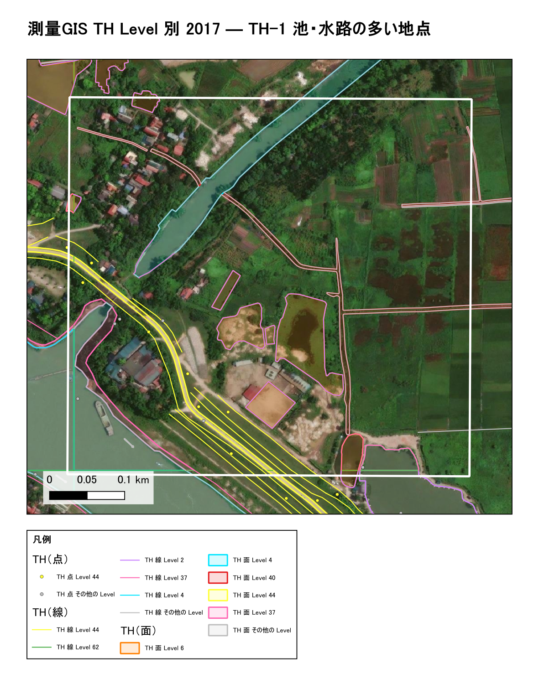
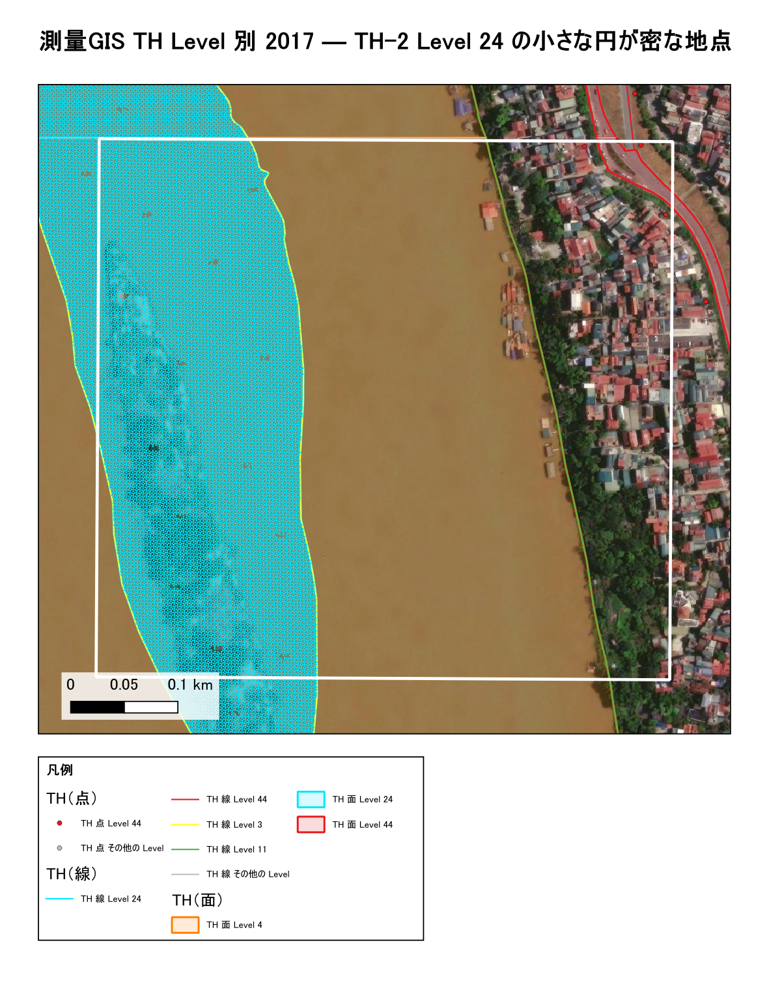

# 測量 GIS TH（水系）の Level 別確認と採否の判定

**最終更新**: 2026-11-18  
**作成方法**: `src/analysis/inventory_survey_gis_attributes.py` による属性の集計（`data/output/survey_gis_attribute_inventory/`）、代表地点の目視（研究者と Claude）、公開水域データとの比較（一時集計、2026-11-18）による  
**関連ドキュメント**: [survey_gis_attribute_inventory.md](survey_gis_attribute_inventory.md)（共通: 方法・属性列・分かっていないこと・問い合わせ事項）, [survey_gis_data_preparation_status.md](survey_gis_data_preparation_status.md)（整備状況）, [gis_data_water.md](../01_planning/gis_data/gis_data_water.md)（公開水域データの一致度。比較に使った水域マスク）, [urban_structure_parameters.md](../01_planning/urban_structure_parameters.md)（水域パラメータ P11・P12 の採否）  
**前提知識**: 測量 GIS は CAD（DGN）由来で、何の地物かは Level（CAD の描画層の番号）から推測するしかない。集計・図の作り方・`Text` の読み方は [survey_gis_attribute_inventory.md](survey_gis_attribute_inventory.md) 1章を参照する

---

## 1. 概要

TH（水系）の主な Level の中身を、集計と代表地点の目視から推定した。線の 93% は Level 24 の極小の円である。

そのうえで、水面の面を公開水域データと比べ、**TH を説明変数の元データとして使わない（不採用）と研究者が判定した**（2026-11-18。5章）。大きな水域の情報は公開データとほぼ同じで、TH にしかない水面には測量（2015〜2017年）より後に水がなくなった所が含まれるためである。

---

## 2. 主な Level の推定

主な Level だけを載せる（表に載せた Level でレイヤの地物の 99.5% 以上を占める）。大きさは線の長さ・面の面積の中央値。形の「円」は `Type` 15（楕円）の線である。全 Level の件数は `levels.csv` を参照する。

| Level | 主な形と件数 | 大きさ | 同じ Level の注記（解読は未確認） | 推定 | 図 |
|---:|---|---:|---|---|---|
| 24 | 線（極小の円）49,727 | 0.9 m | なし | 川の中の砂州などを埋める模様（`GraphicGroup` 2 が 36,129 件） | TH-2 |
| 4 | 面 79 | 11,803 m²（最大 103 万 m²） | なし | 河川・水路の水面 | TH-1・TH-2・TH-3 |
| 6 | 面 903 | 456 m²（最大 94 万 m²） | 「Hồ Tây」1 件 | 池・湖の水面 | TH-1・TH-3 |
| 8 | 面 27 | 20,280 m²（最大 88 万 m²） | なし | 湖の水面。西湖の一部 | TH-3 |
| 40 | 面 248 | 584 m² | なし | 細い水路・溝の水面（推定） | TH-1 |
| 2 | 線 921・面 12 | 70.6 m | なし | 水域の縁（推定） | TH-1 |
| 37 | 線 892・面 37 | 67.4 m | なし | 水域の縁（推定） | TH-1 |
| 39 | 線 620 | 114.8 m | なし | 不明 | — |
| 3 | 線 209 | 87.8 m | なし | 水路の縁（推定） | TH-2・TH-3 |
| 11 | 線 208 | 186.5 m | なし | 川岸（推定） | TH-2 |
| 44 | 点 194・線 261・面 46 | 90.3 m | 数値（2,0 など）、「điếm canh đê」（堤防の見張り小屋） | 堤防とその付属施設 | TH-1・TH-2 |
| 62 | 線 328 | 10.5 m | なし | 図葉の境目で形を閉じる線（GT の Level 62 と同じとみられる） | TH-1・TH-3 |
| 48・47・45 | 点 125・27・26 | — | 川・湖の名前（sông Tô Lịch、Sông Hồng、Hồ Tây など） | 水域名の注記 | — |
| 52 | 点 27 | — | 「đê Hữu Hồng」（紅河右岸堤）など | 堤防名の注記 | — |
| 38 | 点 30・面 11 | — | 「trạm bơm」（ポンプ場） | ポンプ場 | — |
| 21 | 面 17・点 4 | 20.6 m² | 「giếng」（井戸） | 井戸 | — |

TH-3 では、**同じ湖（西湖）の水面が、図葉の境目（Level 62 の直線）を境に Level 8 の面と Level 6 の面に分かれている**。図葉によって同じ地物の Level が違う可能性がある。

---

## 3. 目視確認の記録

図の表示（色・白い枠・背景の衛星画像と出典）と地点の選び方は、[survey_gis_attribute_inventory.md](survey_gis_attribute_inventory.md) 1.2節を参照する。

### TH-1 池・水路の多い地点

- **研究者**: 地点ごとの所見は記録していない。公開水域データと重ねた目視（4.4節）で TH を不採用と判定したため
- **Claude**: Level 4 の面が水路の水面に重なる。Level 44 の線は堤防の法面に沿って何本も平行に走る。Level 6 の面は池に見える区画だが、衛星画像では水のない所もある（埋め立てか、測量後の変化かは未確認）。Level 40 の細い面は水路沿いの溝に見える。Level 62 の直線は図葉の境目に沿う

### TH-2 Level 24 の小さな円が密な地点

- **研究者**: TH-1 と同じ
- **Claude**: Level 24 の極小の円が紅河の中の砂州を埋める。Level 4 の面は川の水面、Level 11 の線は川岸、Level 44 の線・面は右上の堤防（道路）に重なる

### TH-3 Level 3・4 のある地点

- **研究者**: TH-1 と同じ
- **Claude**: 西湖の水面が Level 8 と Level 6 の 2 つの面に分かれ、境目は Level 62 の直線（図葉の境目）と一致する。Level 3 の線と Level 4・18 の小さな面は、街中の細い水路に沿う

---

## 4. 公開水域データとの比較（2026-11-18）

TH の水面が、研究で使っている公開水域データ（`LULC_WATER_COV` の元の GLC など）に足りない情報を持つかを確かめるため、両者を重ねて比べた。集計は一時的なスクリプトで行い、リポジトリには残していない。

### 4.1 方法

- **比べた範囲**: 測量 GIS 有効域（`data/gis/survey/hanoi_survey_extent.gpkg`）の内側に完全に入る 30 m のセル 110,406 個（約 99 km²）
- **公開水域データ**: [gis_data_water.md](../01_planning/gis_data/gis_data_water.md) 7章の水域マスク `data/gis/water/comparison/water_masks_hanoi_20220906.tif`（30 m の正準グリッド、EPSG:5897）。GLC 2022・Esri 2022・JRC（出現頻度 50% 以上・2021年の年次・2021年9月の月次）・観測日 2022-09-06 の MNDWI 0 以上の 7 種類
- **TH の水面**: Level 4・6・8・40 の面。3 m に細かく分けて塗り、セルごとの面積率にした。面積率 0.5 以上を水域とした（水域マスクと同じ規則）
- **指標**: IoU（両方が水域のセル ÷ どちらかが水域のセル）、TH 基準の一致率（TH が水域としたセルのうち相手も水域とした割合）、相手基準の一致率
- **TH だけが水域のセルの内訳**: セルの中心がどの Level の面に入るかと、そのセルの JRC の出現頻度（1984〜2021年に水域として写った割合。`data/gis/water/jrc_gsw/jrc_gsw_hanoi_y2021_m202109.tif` の第 1 バンド）を数えた
- **目視**: 「TH だけが水域」と「公開データだけが水域」を色分けしたラスタを QGIS で衛星画像（Esri World Imagery）に重ねた。TH-1〜3 に加え、Level 6 の「TH だけが水域」のセルが集まる 500 m 四方を 4 地点（W-1〜4）選んだ

時点の違いに注意する。TH は 2015〜2017年、公開データは 2021〜2022年（JRC の出現頻度は 1984〜2021年の通算）である。

### 4.2 全体の一致

TH の水面は 18,146 セル（16.3 km²）である。

| 相手 | 相手の水域セル | IoU | TH 基準の一致率 | 相手基準の一致率 | 相手 ÷ TH |
|---|---:|---:|---:|---:|---:|
| GLC 2022 | 15,325 | 0.769 | 0.802 | 0.949 | 0.84 |
| Esri 2022 | 17,015 | 0.831 | 0.880 | 0.938 | 0.94 |
| JRC 出現頻度 50% 以上 | 14,798 | 0.772 | 0.791 | 0.970 | 0.82 |
| JRC 2021年（季節＋恒常） | 15,376 | 0.784 | 0.812 | 0.958 | 0.85 |
| JRC 2021年（恒常のみ） | 13,511 | 0.739 | 0.742 | 0.995 | 0.75 |
| JRC 2021年9月 | 12,235 | 0.777 | 0.793 | 0.975 | 0.81 |
| MNDWI 0 以上 | 15,574 | 0.808 | 0.833 | 0.964 | 0.86 |

JRC の年次・月次・MNDWI は欠測のセルを除いて数えた（JRC 2021年9月は 91,091 セル、それ以外は 11 万セル前後）。

- **公開データが水域としたセルは、94〜99.5% が TH でも水域である**。一方、公開データの水域は TH の 75〜94% にとどまり、TH の方が広く水域とする
- 同じ範囲で公開データどうしを比べると、IoU は 0.823（GLC と Esri）〜0.912（JRC 2021年9月と MNDWI）である。**TH と公開データの一致（0.74〜0.83）は、公開データどうしの一致より低い**

### 4.3 Level 別の一致と、TH だけが水域のセル

Level ごとに、その Level の面がセルの半分以上を覆うセルのうち、公開データが水域とした割合（7 種類の範囲）:

| Level | セル数 | 公開データが水域とした割合 |
|---:|---:|---|
| 4（河川・水路） | 8,986 | 82〜93% |
| 8（湖） | 5,207 | 86〜95% |
| 6（池・湖） | 3,859 | 42〜70% |
| 40（細い水路・溝） | 91 | 0〜3% |

GLC と比べて TH だけが水域とした 3,595 セルの内訳と、そのセルの JRC の出現頻度:

| セルの中心の Level | セル数 | 出現頻度 0（一度も水域として写っていない） | 1〜24% | 25〜49% | 50% 以上 |
|---|---:|---:|---:|---:|---:|
| 4 | 1,456 | 24% | 8% | 16% | 52% |
| 6 | 1,571 | 62% | 26% | 9% | 3% |
| 8 | 360 | 57% | 13% | 6% | 24% |
| 40 | 92 | 91% | 9% | 0% | 0% |
| 面の外（縁のセル） | 116 | 69% | 19% | 9% | 3% |

- Level 4 の「TH だけが水域」の半分は、JRC が長期的には水域とする所である。細い水路や川岸を GLC が取りこぼしている（TH-1 の水路、TH-3 の西湖の岸）
- Level 6・40 の「TH だけが水域」の大半は、衛星では一度も水域として写っていない。30 m より小さい池・溝か、植物に覆われた池か、水がなくなった所である（4.4節）
- 逆に、GLC だけが水域とした 774 セルの 49% は TH の水面に隣接する（縁の差）。TH-2 では、紅河の砂州の西側の今は水が流れる所を、TH は水面として描いていない。川の流れが測量後に変わった可能性がある（未確認）

### 4.4 目視（W-1〜4）

範囲は EPSG:4326 の xmin, ymin, xmax, ymax（500 m 四方）。JRC の欄は、その地点の「TH だけが水域」の Level 6 のセルの出現頻度である。

| 地点 | 範囲 | JRC | Claude の所見 |
|---|---|---|---|
| W-1 | 105.790199, 21.072523, 105.795034, 21.077016 | 0% | 池の大部分が植物（蓮とみられる）に覆われる。左側に埋め立てたように見える白い区画がある |
| W-2 | 105.791968, 21.079560, 105.796804, 21.084053 | 0% | 曲がった水路の形の池が造成中で、底が出ていて水がほとんどない。北側の明るい緑色の水路は TH にも GLC にもない（測量後に掘られた可能性） |
| W-3 | 105.816183, 21.072942, 105.821019, 21.077435 | 1〜49% | 四角い池が並び、どれも植物（蓮とみられる）に覆われる。西湖の北側 |
| W-4 | 105.817585, 21.065348, 105.822421, 21.069841 | 1〜49% | 西湖の岸の、堤で囲まれた池。全体が植物に覆われる。西湖の岸沿いにも「TH だけが水域」のセルが並ぶ（縁の差） |

- **研究者**: 地図データ（TH）では水域だが GLC ではそうでない所と、その逆の所がある。今は明らかに水域でないのに TH だけが水域とする地点もある（2026-11-18）
- 「蓮とみられる」は衛星画像の見た目からの Claude の推定であり、未確認である

---

## 5. 採否の判定

**判定: TH は説明変数の元データとして使わない（不採用）**（2026-11-18、研究者判定）。付録の測量建物置き換えでも使わない。

理由:

1. **研究の設計に TH を使う変数がない**。水域被覆率（P11）・水域近接距離（P12）は保留であり、水域の割合は GLC 由来の `LULC_WATER_COV` として分析に入っている（[urban_structure_parameters.md](../01_planning/urban_structure_parameters.md)）。付録の置き換えは建物の変数だけを対象とする
2. **30 m〜300 m の分析で新しく得られる情報が少ない**。大きな水域（Level 4・8）は公開データでも 82〜95% が水域であり、公開データが水域とした所は TH でもほぼ水域である（4.2・4.3節）
3. **今の状態と合わない所がある**。今は水がない所を TH だけが水域とし（W-1・W-2・TH-1）、今は水が流れる所を TH が描いていない（TH-2）。測量（2015〜2017年）からの変化とみられる
4. **範囲が中心部の約 99 km² に限られる**

TH の面は、細い水路や植物に覆われた池を公開データより細かく捉えている。将来 P11・P12 の採否を見直す場合や、`LULC_WATER_COV` の元データを差し替える感度分析を行う場合に、測量範囲の中で公開データの取りこぼしを確かめる参照には使える可能性がある。また、DH の標高点の検査では、点のないマスが水面かどうかの確認に TH の水面の面を使った（[survey_gis_dh_inventory.md](survey_gis_dh_inventory.md) 4章）。いずれも説明変数としての使用ではない。

不採用としたため、TH の Level の意味（同じ種類の水面に複数の Level がある理由、Level 24・39 の意味）は地図の作成者に問い合わせない。
