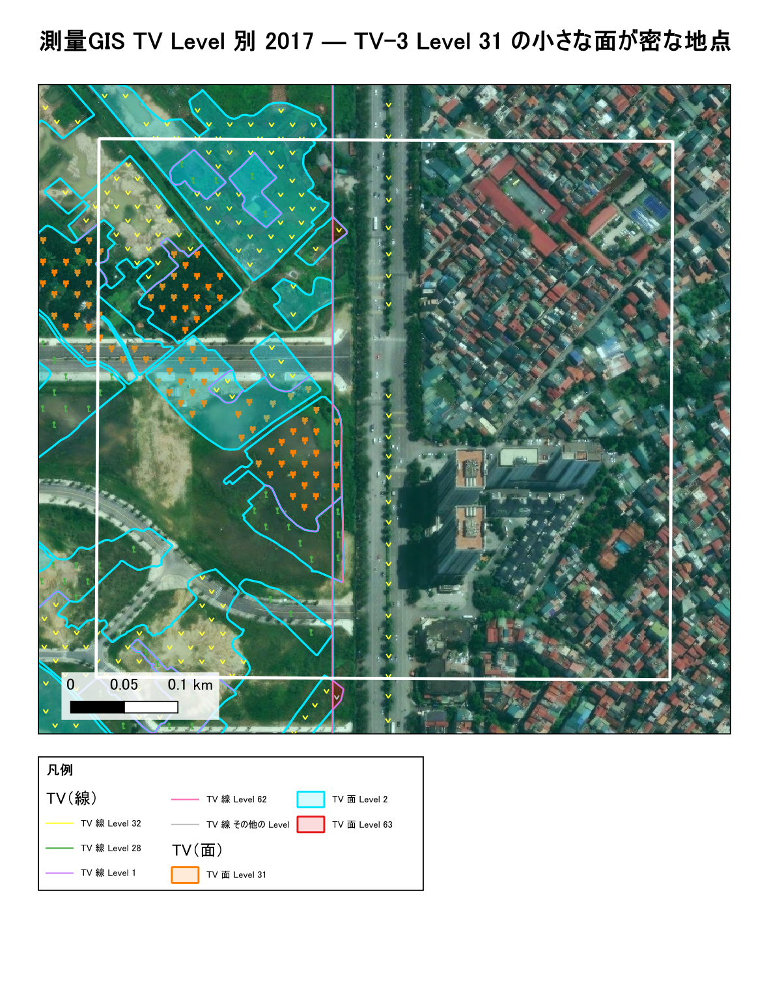

# 測量 GIS TV（植生・土地利用）の Level 別確認

**最終更新**: 2026-11-18  
**作成方法**: `src/analysis/inventory_survey_gis_attributes.py` による属性の集計（`data/output/survey_gis_attribute_inventory/`）と、代表地点の目視（研究者と Claude）による  
**関連ドキュメント**: [survey_gis_attribute_inventory.md](survey_gis_attribute_inventory.md)（共通: 方法・属性列・分かっていないこと・問い合わせ事項）, [survey_gis_data_preparation_status.md](survey_gis_data_preparation_status.md)（整備状況）  
**前提知識**: 測量 GIS は CAD（DGN）由来で、何の地物かは Level（CAD の描画層の番号）から推測するしかない。集計・図の作り方・`Text` の読み方は [survey_gis_attribute_inventory.md](survey_gis_attribute_inventory.md) 1章を参照する

---

## 1. 概要

TV（植生・土地利用）の主な Level の中身を、集計と代表地点の目視から推定した結果を記録する。面の区画と、短い線でできた記号から成る。注記はほぼない（8 件）。

---

## 2. 主な Level の推定

主な Level だけを載せる（表に載せた Level でレイヤの地物の 99.5% 以上を占める）。大きさは線の長さ・面の面積の中央値。形の「円」は `Type` 15（楕円）の線である。全 Level の件数は `levels.csv` を参照する。

| Level | 主な形と件数 | 大きさ | 推定 | 図 |
|---:|---|---:|---|---|
| 2 | 面 3,984・線 191 | 2,005 m²（最大 125 万 m²） | 区画の境界。植生の区域に限らず住宅地も覆う | TV-1・TV-2・TV-3 |
| 36 | 面 326 | 3,123 m² | 区画（種類は不明） | TV-1 |
| 5 | 線 951・面 60 | 線 7.0 m・面 3,451 m² | 不明 | — |
| 62 | 線 645・面 12 | 38.8 m | 不明（境目の線か） | — |
| 1 | 線 1,427 | 46.1 m | 区画の境界の線（推定） | TV-2・TV-3 |
| 28 | 線 31,770 | 3.4 m | 記号（樹木の区画に並ぶ） | TV-1・TV-2 |
| 41 | 線 27,486 | 2.0 m | 記号（田畑の区画に並ぶ） | TV-1 |
| 42 | 線 17,425 | 3.0 m | 記号 | TV-2 |
| 32 | 線 17,419 | 7.0 m | 「v」形の記号（草地・道路の中央分離帯に並ぶ） | TV-3 |
| 35 | 線 15,348・面 805 | 線 3.4 m | 記号（集落の中に並ぶ） | TV-1・TV-2 |
| 4 | 線 4,560・面 1,717 | 線 7.5 m・面 1.5 m² | 記号 | TV-1 |
| 21 | 線 1,514 | 3.0 m | 「॥」形の記号（堤防の法面に並ぶ） | TV-1・TV-2 |
| 31 | 面 1,460 | 0.6 m² | ハート形に近い記号（公園の樹木の区画に並ぶ） | TV-3 |

- 記号の Level のうち 42・28・32・31 は、`GraphicGroup` が 0 以外の地物が多い（例: Level 42 は 17,427 件中 15,910 件）。複数の線を 1 つの記号としてまとめているとみられる。一方、Level 41・35・21 はほとんどが 0 で、まとめ方は Level によって違う
- 区画の種類（田・樹木・草地など）は、区画そのものの属性ではなく、**区画の中に置いた記号の Level で表している**とみられる。記号の Level と種類の対応は分からない
- **Level 2 の面は重なっている**。3,984 面のうち 996 面は、別の面とまったく同じ形の重複である（形を正規化した WKB の一致で判定）。面積の合計 91.5 km² に対し、和集合は 76.2 km²（測量 GIS 有効域 99.9 km² の約 4 分の 3）である。大きな面の中に小さな面が入れ子になっている所もある（TV-1）。Level 36 の面には重複がない（合計 1.90 km²・和集合 1.89 km²）

---

## 3. 目視確認の記録

図の表示（色・白い枠・背景の衛星画像と出典）と地点の選び方は、[survey_gis_attribute_inventory.md](survey_gis_attribute_inventory.md) 1.2節を参照する。

### TV-1 Level 41・28 の短い線が密な地点

- **研究者**: （記入待ち）
- **Claude**: Level 2 の面が区画を区切り、右側の田畑には Level 41 の記号、川沿いの樹木には Level 28 の記号、集落には Level 35 の記号、堤防の法面には Level 21 の記号が並ぶ。右側が暗いのは Level 2 の面が何枚も重なっているためである

### TV-2 Level 35・4・5 のある地点

- **研究者**: （記入待ち）
- **Claude**: 住宅地も Level 2 の面で区切られ、その中に Level 35 の記号が並ぶ。左側の大きな Level 35 の面は草地・樹木の区画に重なる。Level 28・42 の記号は畑・樹木の区画に並ぶ

### TV-3 Level 31 の小さな面が密な地点

- **研究者**: （記入待ち）
- **Claude**: Level 31 の小さな面（ハート形に近い記号）が公園の樹木の区画に並ぶ。Level 32 の「v」形の記号は草地と道路の中央分離帯に並ぶ。右側の市街地には TV の地物がない
