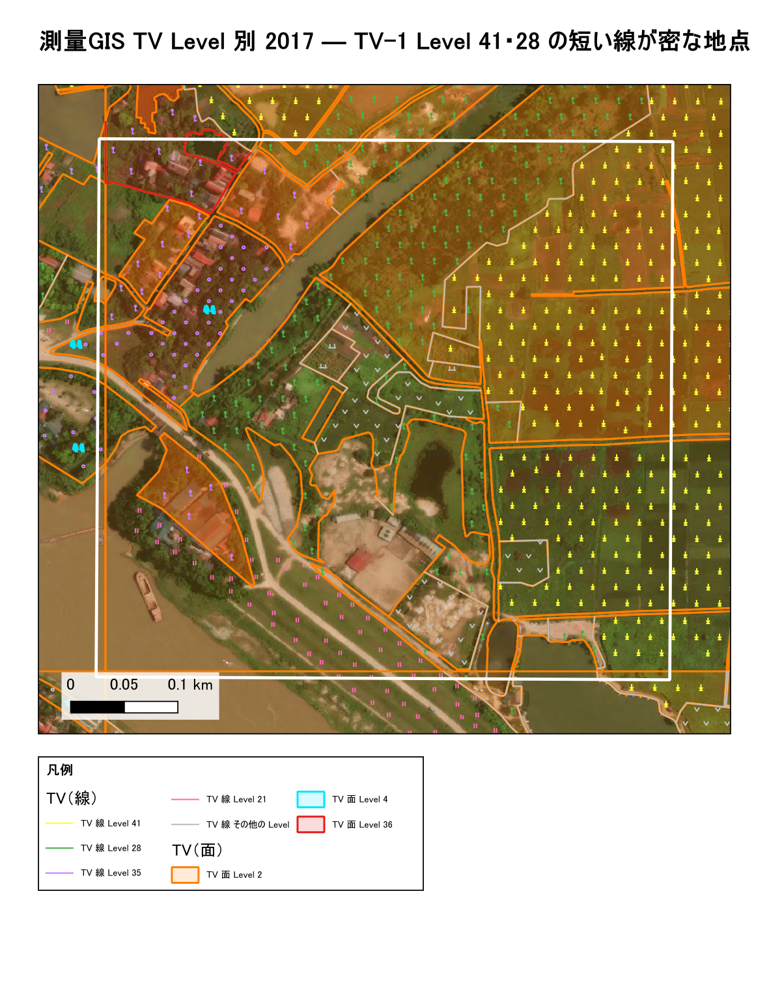
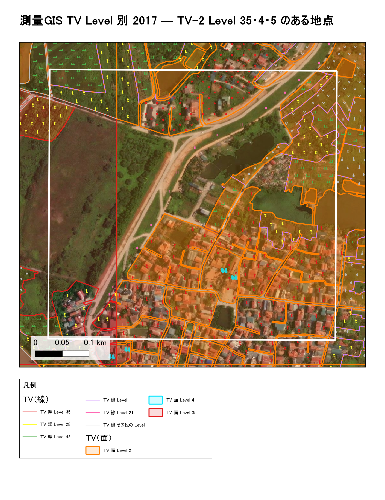

# 測量 GIS TV（植生・土地利用）の Level 別確認と使える見込み

**最終更新**: 2026-11-19  
**作成方法**: `src/analysis/inventory_survey_gis_attributes.py` による属性の集計（`data/output/survey_gis_attribute_inventory/`）、代表地点の目視（研究者と Claude）、公開土地被覆データ・NDVI・LST との比較と区画への記号の割り当て（一時集計、2026-11-18）による  
**関連ドキュメント**: [survey_gis_attribute_inventory.md](survey_gis_attribute_inventory.md)（共通: 方法・属性列・分かっていないこと・問い合わせ事項）, [survey_gis_data_preparation_status.md](survey_gis_data_preparation_status.md)（整備状況）, [urban_structure_parameters.md](../01_planning/urban_structure_parameters.md)（土地被覆クラス別面積率 P7・植生被覆率 P8・NDVI P16 の定義）  
**前提知識**: 測量 GIS は CAD（DGN）由来で、何の地物かは Level（CAD の描画層の番号）から推測するしかない。集計・図の作り方・`Text` の読み方は [survey_gis_attribute_inventory.md](survey_gis_attribute_inventory.md) 1章を参照する

---

## 1. 概要

TV（植生・土地利用）の主な Level の中身を、集計と代表地点の目視から推定した結果を記録する。面の区画と、短い線でできた記号から成る。注記はほぼない（8 件）。

公開土地被覆データ（GLC・Esri）と比べると、TV の樹木・草地の記号の位置は公開データでは農地や市街地とされ、2022 年の NDVI は高く LST は低い（4章）。区画の中の記号はほぼ 1 種類にそろい、区画ごとに種類を決められる見込みがある（5章）。説明変数に使えるかは、記号の意味の確認などを条件として**保留**とした（6章）。

---

## 2. 主な Level の推定

主な Level だけを載せる（表に載せた Level でレイヤの地物の 99.5% 以上を占める）。大きさは線の長さ・面の面積の中央値。形の「円」は `Type` 15（楕円）の線である。全 Level の件数は `levels.csv` を参照する。

| Level | 主な形と件数 | 大きさ | 推定 | 図 |
|---:|---|---:|---|---|
| 2 | 面 3,984・線 191 | 2,005 m²（最大 125 万 m²） | 区画の境界。植生の区域に限らず住宅地も覆う。図葉の枠とみられる大きな面もある（5.2節） | TV-1・TV-2・TV-3 |
| 36 | 面 326 | 3,123 m² | 区画（種類は不明） | TV-1 |
| 5 | 線 951・面 60 | 線 7.0 m・面 3,451 m² | 不明 | — |
| 62 | 線 645・面 12 | 38.8 m | 不明（境目の線か） | — |
| 1 | 線 1,427 | 46.1 m | 区画の境界の線（推定） | TV-2・TV-3 |
| 28 | 線 31,770 | 3.4 m | 記号（樹木の区画に並ぶ） | TV-1・TV-2 |
| 41 | 線 27,486 | 2.0 m | 記号（田畑の区画に並ぶ） | TV-1 |
| 42 | 線 17,425 | 3.0 m | 記号 | TV-2 |
| 32 | 線 17,419 | 7.0 m | 「v」形の記号（草地・道路の中央分離帯のほか、帯状の畑にも並ぶ。5.3節） | TV-3 |
| 35 | 線 15,348・面 805 | 線 3.4 m | 記号（集落の中に並ぶ） | TV-1・TV-2 |
| 4 | 線 4,560・面 1,717 | 線 7.5 m・面 1.5 m² | 記号 | TV-1 |
| 21 | 線 1,514 | 3.0 m | 「॥」形の記号（堤防の法面に並ぶ） | TV-1・TV-2 |
| 31 | 面 1,460 | 0.6 m² | ハート形に近い記号（公園の樹木の区画に並ぶ） | TV-3 |

- 記号の Level のうち 42・28・32・31 は、`GraphicGroup` が 0 以外の地物が多い（例: Level 42 は 17,427 件中 15,910 件）。複数の線を 1 つの記号としてまとめているとみられる。一方、Level 41・35・21 はほとんどが 0 で、まとめ方は Level によって違う
- 区画の種類（田・樹木・草地など）は、区画そのものの属性ではなく、**区画の中に置いた記号の Level で表している**とみられる。記号の Level と種類の対応表はない。Level 41 が田畑、Level 35 が集落という推定は、公開データとの比較でも裏付けられた（4.2節）が、ほかの Level は目視による推定にとどまる
- **Level 2 の面は重なっている**。3,984 面のうち 996 面は、別の面とまったく同じ形の重複である（形を正規化した WKB の一致で判定）。面積の合計 91.5 km² に対し、和集合は 76.2 km²（測量 GIS 有効域 99.9 km² の約 4 分の 3）である。大きな面の中に小さな面が入れ子になっている所もある（TV-1）。Level 36 の面には重複がない（合計 1.90 km²・和集合 1.89 km²）

---

## 3. 目視確認の記録

図の表示（色・白い枠・背景の衛星画像と出典）と地点の選び方は、[survey_gis_attribute_inventory.md](survey_gis_attribute_inventory.md) 1.2節を参照する。

### TV-1 Level 41・28 の短い線が密な地点

- **研究者**: Claude の所見と同じであることを目視で確認した（2026-11-18）
- **Claude**: Level 2 の面が区画を区切り、右側の田畑には Level 41 の記号、川沿いの樹木には Level 28 の記号、集落には Level 35 の記号、堤防の法面には Level 21 の記号が並ぶ。右側が暗いのは Level 2 の面が何枚も重なっているためである

### TV-2 Level 35・4・5 のある地点

- **研究者**: Claude の所見と同じであることを目視で確認した（2026-11-18）
- **Claude**: 住宅地も Level 2 の面で区切られ、その中に Level 35 の記号が並ぶ。左側の大きな Level 35 の面は草地・樹木の区画に重なる。Level 28・42 の記号は畑・樹木の区画に並ぶ

### TV-3 Level 31 の小さな面が密な地点

- **研究者**: Claude の所見と同じであることを目視で確認した（2026-11-18）
- **Claude**: Level 31 の小さな面（ハート形に近い記号）が公園の樹木の区画に並ぶ。Level 32 の「v」形の記号は草地と道路の中央分離帯に並ぶ。右側の市街地には TV の地物がない

---

## 4. 公開土地被覆データ・NDVI・LST との比較（2026-11-18）

TV が、研究で使っている土地被覆クラス別面積率（P7。元データは GLC、感度分析は Esri）や NDVI（P16）に足りない情報を持つかを確かめるため、記号の位置で公開データの値を読んだ。集計は一時的なスクリプトで行い、リポジトリには残していない。

### 4.1 方法

- **対象**: 測量 GIS 有効域（`data/gis/survey/hanoi_survey_extent.gpkg`）の内側にある TV の地物。Level と形（線・面）の組で 300 件以上あるものに限った。4.2節の表では、記号ではない区画の面（Level 2・36）・区画の境界の線（Level 1）と、記号とみなさなかった線（Level 5・62）を除いた。TV は図葉 11-c（図葉 1 枚分）を取り込めていないため、比べた範囲はその分だけ有効域より狭い（[survey_gis_data_preparation_status.md](survey_gis_data_preparation_status.md) 2.6節）。地物ごとに代表点（`representative_point`）を 1 つとった。複数の線で 1 つの記号を描く Level（2章）は、件数が記号の数より多くなる
- **土地被覆**: GLC 2022（`data/gis/lulc/glc_fcs30d/glc_fcs30d_hanoi_2022.tif`）と Esri 2022（`data/gis/lulc/esri_10m/esri_lulc_hanoi_2022.tif`）の代表点の位置の画素を、`src/common/lulc_classes.py` の共通クラスに写像した
- **NDVI・LST**: 分析に使っている観測（2022-09-06）の `data/satellite/indices/2022/INDICES_Landsat8_20220906_032358Z.tif`（第 1 バンド NDVI）と `data/satellite/lst/2022/LST_Landsat8_20220906_032358Z.tif`（°C）を代表点の位置で読んだ
- **基準**: 有効域の中に無作為に置いた 30,000 点（乱数シード 42）を同じ方法で読んだ

時点の違いに注意する。TV は撮影 2015〜2016年・図化 2017年、公開データは 2022年である。

### 4.2 記号の位置の土地被覆

表の値は、各 Level の代表点のうち、その共通クラスの画素に入った割合（%）である。

| Level（形） | 件数 | 推定（2章） | GLC 農地 | GLC 市街地 | Esri 市街地 | Esri 農地 | Esri 樹林 | Esri 草地・低木 | Esri 水域 |
|---|---:|---|---:|---:|---:|---:|---:|---:|---:|
| 41（線） | 27,486 | 田畑 | 99.0 | 1.0 | 5.2 | 93.6 | 0.0 | 1.2 | 0.0 |
| 35（線） | 15,348 | 集落 | 20.7 | 78.5 | 98.9 | 0.9 | 0.0 | 0.0 | 0.2 |
| 28（線） | 31,770 | 樹木 | 83.3 | 11.2 | 71.2 | 19.5 | 5.0 | 1.5 | 2.8 |
| 42（線） | 17,425 | 不明 | 90.4 | 3.1 | 42.4 | 44.9 | 4.7 | 4.3 | 3.6 |
| 32（線） | 17,419 | 草地など | 73.4 | 25.9 | 77.2 | 17.5 | 0.5 | 4.0 | 0.8 |
| 31（面） | 1,460 | 公園の樹木 | 89.7 | 8.9 | 65.5 | 0.0 | 9.2 | 3.6 | 21.8 |
| 21（線） | 1,514 | 堤防の法面 | 73.0 | 25.3 | 80.3 | 4.0 | 0.0 | 14.9 | 0.8 |
| 4（線） | 4,560 | 不明 | 64.1 | 25.0 | 85.3 | 3.8 | 2.0 | 1.4 | 7.5 |
| 4（面） | 1,717 | 不明 | 41.2 | 54.0 | 92.1 | 1.2 | 1.5 | 1.0 | 4.2 |
| 35（面） | 805 | 集落 | 29.7 | 67.5 | 97.5 | 0.6 | 0.0 | 0.5 | 1.4 |
| 3（線） | 306 | 不明 | 88.6 | 11.4 | 61.1 | 0.0 | 38.6 | 0.3 | 0.0 |

- 田畑（Level 41）と集落（Level 35）は、公開データとよく合う
- 樹木・草地の記号（Level 28・31・32・21）の位置は、GLC では大半が農地（73〜90%）、Esri では大半が市街地（66〜80%）である。GLC の樹林クラスは、これらの記号の位置でほぼ 0% だった
- Level 3 は件数が少ないが、Esri の樹林の割合（38.6%）が最も高い

### 4.3 Esri が市街地とした所の NDVI と LST

Esri が市街地とした代表点に限って、NDVI と LST を比べた。件数は Level ごとに線と面を合わせて数えた（4.2節は Level と形の組ごと）。このため、面もある Level 35・4・32 では、4.2節の線の件数に Esri 市街地の割合を掛けた数より多い（35 は約 15,179 件より 785 件、4 は約 3,890 件より 1,583 件、32 は約 13,447 件より 118 件多い）。差は面（35 は 805 件、4 は 1,717 件、32 は 115 件）の分とみられる。基準は、無作為な点のうち Esri が市街地とした点である。

| 地点 | 件数 | NDVI の中央値 | NDVI 0.4 超の割合 | LST の中央値 |
|---|---:|---:|---:|---:|
| 基準（無作為な点） | 23,148 | 0.32 | 33.8% | 36.8 °C |
| Level 28（樹木） | 22,617 | 0.65 | 90.1% | 32.0 °C |
| Level 31（公園の樹木） | 961 | 0.62 | 86.7% | 31.7 °C |
| Level 42 | 7,397 | 0.63 | 94.0% | 32.3 °C |
| Level 41（田畑） | 1,426 | 0.63 | 90.4% | 32.2 °C |
| Level 4 | 5,473 | 0.59 | 80.9% | 33.7 °C |
| Level 32（草地など） | 13,565 | 0.54 | 80.4% | 33.8 °C |
| Level 21（堤防の法面） | 1,216 | 0.54 | 75.5% | 34.4 °C |
| Level 35（集落） | 15,964 | 0.41 | 52.9% | 35.5 °C |

- Esri が市街地とした所でも、TV の樹木の記号（Level 28・31）の位置は NDVI が高く、LST が基準より 5 °C 前後低い。**TV が描く樹木は 2022 年にも残っていて、公開の土地被覆分類はそれを捉えていない**とみられる
- Esri が市街地としなかった点も含めると、植生の記号（Level 21・28・31・32・41・42）の位置の 79〜95% は、NDVI が 0.4 を超える。2017年に描かれた植生の多くは 2022 年にも残っている。ただし、植生がなくなった区画では記号ごと消えているとは限らず（図化後の変化は図に反映されない）、この割合で TV の古さの影響全体を測れたわけではない
- NDVI（P16）は植生の量をすでに捉えている。TV が加えうるのは、樹木・草地・田畑の**種類の区別**と、はっきりした**区画の境界**である

### 4.4 面積の比較

有効域の中の公開データの面積（画素の割合に有効域の面積 99.9 km² を掛けた概算）と、5章で種類を決めた TV の区画の面積を比べた。

| クラス | GLC | Esri | TV の区画（5章、最も多い記号の Level） |
|---|---:|---:|---|
| 樹林 | 0.15 km² | 0.57 km² | Level 28: 2.66 km²・Level 31: 0.07 km² |
| 草地・低木 | 0.35 km² | 1.06 km² | Level 32: 3.73 km²（意味は 5.3節） |
| 農地 | 21.34 km² | 5.49 km² | Level 41: 1.85 km²・Level 42: 1.58 km² |
| 市街地 | 63.22 km² | 77.39 km² | （TV は区画を描かない所が多い。5.2節） |

TV の樹木の区画は、Esri の樹林の約 5 倍、GLC の樹林の約 18 倍である。

---

## 5. 区画への記号の割り当て（2026-11-18）

TV を樹林率などの面積率にするには、区画（Level 2 の面）ごとに種類を決める必要がある。区画の中の記号が 1 種類にそろっているかを調べた。集計は一時的なスクリプトで行い、リポジトリには残していない。

### 5.1 方法

1. 有効域に重なる Level 2 の面を読み、まったく同じ形の重複を 1 面にまとめた（3,984 面 → 2,988 面）
2. 入れ子を解いた。各面から、その内側に完全に入る小さい面を除いた部分を残した
3. 記号の Level（41・28・42・32・35・21・31・4・3）の代表点を、それを含む部分に割り当てた。2 つ以上の部分に入る点は、面積の小さい方に割り当てた
4. 区画ごとに、記号の数と、最も多い Level の割合（以下「純度」）を数えた

### 5.2 結果

面は次の 3 種類に分かれた。

| 種類 | 判定の規則 | 面の数 | 面積（内側の面を除いた部分） | 中の記号の数 |
|---|---|---:|---:|---:|
| 図葉の枠 | 外形が 100 ha を超える（いずれもほぼ長方形） | 44 | 49.16 km² | 2,849 |
| 入れ物 | 内側に別の面を持つ | 199 | 9.29 km² | 22,264 |
| 区画 | 上のどちらでもない | 2,745 | 17.83 km² | 86,380 |

- **区画の中の記号はそろっている**。記号を含む区画は 2,238 面・14.53 km² で、面積の 92.6% は記号が 1 種類だけ、98.3% は純度 80% 以上である。記号を含まない区画は 507 面・3.30 km²
- **有効域の約半分は、どの区画にも入らない背景である**。図葉の枠の、区画を除いた部分（49.16 km²）に記号は 2,849 件しかない。TV が区画を描いていない市街地・道路・川などとみられる。この部分の記号（中央分離帯の草地など）には面積を与えられない
- 記号の代表点 119,939 件のうち 8,446 件（7.0%）は、どの Level 2 の面にも入らなかった
- **区画とみなせない面が残る**。外形が 100 ha 以下でも、図葉の枠の一部とみられる面があった（5.3節の TV区画-B）。本物の区画は記号が密で、1 ha あたりの記号の数の中央値は Level 41 で 113、Level 28 で 77、Level 32 で 37 である。記号が 1 ha あたり 5 未満の区画（15 面・約 1.0 km²）を除くと、残りは 2,223 面・13.49 km² になる（4.4節の面積はこの値）。5 という閾値は仮に置いたもので、妥当性は確かめていない
- 入れ物の面は、内側の面の数の中央値が 2 であり、池などを内側に持つ本物の区画と、背景にあたる面が混ざっているとみられる。今回は種類を決める対象から外した

### 5.3 目視

区画を最も多い記号の Level で色分けし、QGIS で衛星画像（Esri World Imagery）に重ねた。区画のファイル（geopandas で書き出したもの）は QGIS で座標系が正しく読まれず約 220 m ずれて表示されていたため、EPSG:5897 を明示して見直した（2026-11-18）。見直し後も所見は変わらなかった。

| 地点 | 範囲（経度・緯度） | Claude の所見 |
|---|---|---|
| TV-1 | 105.85597〜105.86081, 21.07186〜21.0764 | 田畑（Level 41）と川沿いの樹木（Level 28）の区画は衛星画像と合う |
| TV区画-A | 105.8265〜105.8315, 21.0745〜21.0775 | 細長い帯状の畑の区画に Level 32 の「v」形の記号が一面に並ぶ。TV-3 では草地・中央分離帯に並んでおり、Level 32 の意味は一つに決まらない。何を育てている畑かは未確認 |
| TV区画-B | 105.823〜105.847, 21.0705〜21.0835 | 川面にかかる 92.3 ha の四角い面が、中の 9 件の記号だけで Level 28 と判定された。図葉の枠の一部とみられる |

---

## 6. 使える見込み

**判定: 保留**（2026-11-18、研究者判断）。TV は、公開の土地被覆データにない樹木・草地の区画を持ち（4章）、区画ごとに種類を決められる見込みがある（5章）。条件がそろえば、樹林率などの面積率の元データとして使える見込みがある。

条件:

1. **記号の Level の意味を地図の作成者に確かめる**。とくに、区画の面積が大きい Level 32 は、草地と畑の両方に並び（5.3節）、取り違えると面積率への影響が大きい。Level 42・4・35 も確定していない（[survey_gis_attribute_inventory.md](survey_gis_attribute_inventory.md) 5章 2-2・3-7）
2. **区画とみなさない面（図葉の枠・記号のまばらな面・入れ物）の扱いを決める**（5.2節）
3. **図化が 2017年であることを明記する**。植生の記号の位置の多くは 2022 年にも NDVI が高い（4.3節）が、図化後に植生がなくなった区画は確かめていない

付録の測量建物置き換えは、建物と道路の測量 GIS だけを確認した段階で定義したものであり、TV を使わない理由にはしない（研究者の指摘）。TV を分析に入れるかと、入れる場合のシナリオの定義は、問い合わせの回答を踏まえて別に判断する。
